# TODAK (토닥) — 방울토마토 스마트 농업 정보시스템

> 경기도 양평군 비닐하우스 1동(100평, 330.58㎡)의 방울토마토 재배 환경을 1분 단위로 수집·분석하고, 기준값에 맞춰 환기·난방·차광·관수를 자동 제어하는 웹 시스템입니다.
> **현재 모든 센서 값과 장치는 가상 센서 시뮬레이터(B안)입니다.** 실제 양평 기상 관측값이나 농가 실측값이 아닙니다.

버전 v1.1 · 데이터 기획 및 분석 1학기 중간고사 대체과제 (가상 사업: 5,000만 원, 12주, 폭포수)

저장소: https://github.com/jiwon2324/TODAK-SmartFarm (공개)

---

## 1. 프로젝트 소개

TODAK은 농가가 하우스에 가지 않아도 휴대폰·PC로 온도·습도·CO₂·일사·배지 수분·EC·pH를 확인하고, 이상이 생기면 알림을 받고, 필요하면 원격으로 장치를 움직일 수 있게 하는 정보시스템입니다. 관리자는 사용자·농장·센서·장치·기준값을 관리하고 시스템 상태를 감시합니다.

| 구성 | 내용 |
|---|---|
| 프런트엔드 | React 18 + TypeScript + Tailwind CSS + Recharts (반응형 웹, 360~1920px) |
| 백엔드 | Spring Boot 3.3 (Java 21) · Spring Security + JWT · JPA · Flyway |
| DB | MySQL 8.4 (22개 테이블) |
| IoT | MQTT (Mosquitto 2.0) · 가상 센서·장치 시뮬레이터 (Python) |
| 실행 | Docker Compose 5개 컨테이너 |

## 2. 개발 목적

- 손으로 하던 6가지 작업(씨 뿌리기·햇빛·온도·영양액·수정·수확) 중 온도는 완전 자동화, 광·양액은 부분 자동화, 수정·수확은 의사결정 지원으로 바꿉니다 (개발 계획서 6장).
- 야간·주말 관리 공백과 양평 겨울 저온 피해를 줄입니다.
- 내부 센서 GDD와 기상청 외부 GDD를 나란히 보여 난방 효과를 설명합니다.

## 3. 사업 조건 (양평 · 100평 · 방울토마토)

| 항목 | 조건 |
|---|---|
| 위치 | 경기도 양평군 (기상청 ASOS 양평 202 지점) |
| 시설 | 단동 비닐하우스 1동, 100평 = 330.58㎡ (약 41.5m × 8m), 관리 구역 2개 (Z1 입구측, Z2 안쪽) |
| 작물 | 방울토마토, 코이어 배지 양액재배(가정) |
| 사업비 | 50,000,000원 (VAT 포함, 고정) |
| 기간 | 12주 (2026.11.02 ~ 2027.01.22, 가상 사업 기간) |
| 방법론 | 폭포수 (요구사항 → 설계 → 구현 → 시험 → 인도) |

## 4. 주요 기능

| 구분 | 기능 | 요구사항 |
|---|---|---|
| 계정 | 로그인(아이디 저장·비밀번호 보기·Caps Lock 경고), **회원가입 3단계 → 관리자 승인**, 비밀번호 찾기(관리자 초기화 요청), 내 정보, 임시 비밀번호 첫 로그인 강제 변경, 5회 실패 10분 잠금 | REQ-F-12 |
| 권한 | 관리자(ADMIN) · 농가(FARMER) · 조회 전용(VIEWER), 사용자별 농장 접근 제한 — **백엔드 API에서 검사** | REQ-F-12 |
| 메뉴 | 계획서 화면 구조도대로 대시보드 + 7개(환경 그래프·장치 제어·제어 이력·알림·재배 기준값/제어 규칙·생육 분석·수확 판별), 관리자 '설정' 묶음, 모바일 하단 탭 5개(더보기 포함) | 16장 |
| 농가 대시보드 | 구역 탭, 최신값 카드(11채널)와 최종 수집 시각, 오늘 DLI·누적 GDD, 24시간 그래프, 장치 상태, 미해결 알림, SSE 실시간 갱신 | F-01, F-18 |
| 환경 분석 | 시간별 온습도, 지표·집계 선택, 일별 평균·최고·최저·일교차·DIF, DLI, **GDD(내부·외부 분리)**, 35℃/5℃ 일수, 결측·불완전 표시, CSV | F-10, F-14 |
| 제어 | 수동 제어(확인 절차·수동 유지 시간), 자동/수동 전환, 명령 상태(요청·전송·실행 확인·실패·응답 없음), 이력 필터 | F-08, F-16 |
| 자동 제어 | CR-01~07 히스테리시스·최소 작동·지속 시간·간격·2단계 환기·안전 한계 우선 | F-02~04 |
| 알림 | 기준 이탈·센서 무응답·이상치·장치 무응답·통신 장애·벌통 교체·개화기 고온다습, 30분 중복 억제 | F-06, F-09 |
| 재배 관리 | 생육 단계·정식일·GDD 기준/상한 온도, 단계별 기준값 버전, 벌통 교체 | F-06, F-11, F-14 |
| 관리자 | 시스템 현황, 사용자 승인·관리, 구역·센서·장치, 기준값·규칙, 로그(수집·명령·알림·오류·설정 변경), 기상 CSV, 시뮬레이터 시나리오 | F-12, F-13, F-15, F-17 |

계획서와 하나씩 대조한 결과는 [계획서 대비 구현 검토서](docs/Development_Plan/계획서_대비_구현_검토.md)에 있습니다.

## 5. 기술 스택

| 영역 | 기술 (버전) |
|---|---|
| Frontend | React 18.3.1, TypeScript 5.6, Vite 5.4, Tailwind CSS 3.4, Recharts 2.12, React Router 6.26 |
| Backend | Java 21, Spring Boot 3.3.5, Spring Security 6, jjwt 0.12.6, Spring Data JPA, Flyway, springdoc-openapi (Swagger) |
| DB | MySQL 8.4 |
| IoT | Eclipse Mosquitto 2.0.20, Eclipse Paho MQTT, paho-mqtt 2.1 (Python 3.12) |
| Test | JUnit 5 + 실제 MySQL 통합 테스트, Vitest + Testing Library, Playwright E2E, k6 |
| Infra | Docker Compose, nginx 1.27, GitHub Actions(작성됨) |

## 6. 전체 시스템 아키텍처

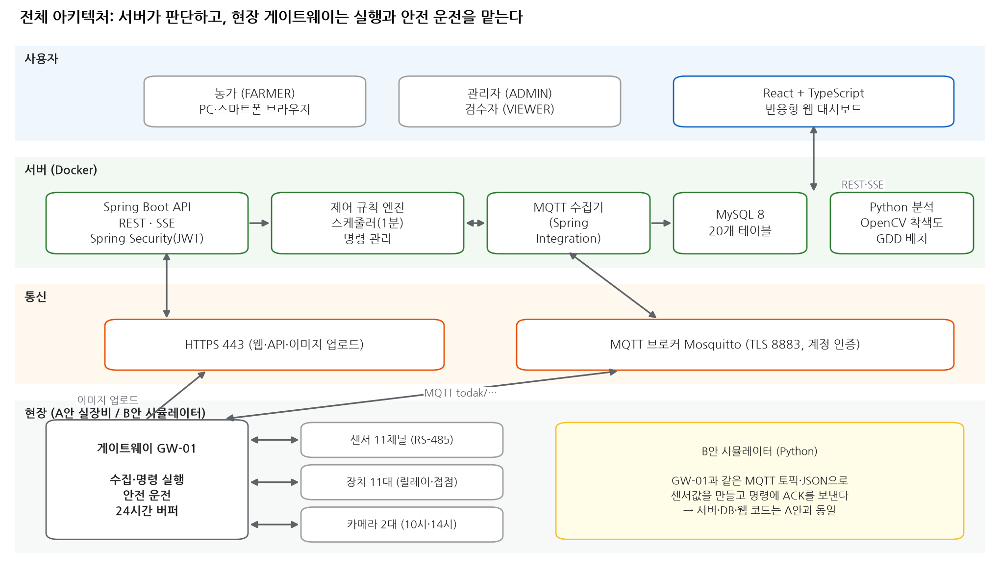

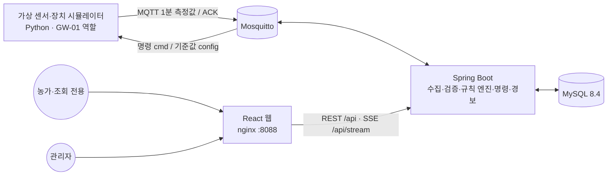

## 7. 통신 수집 구조도

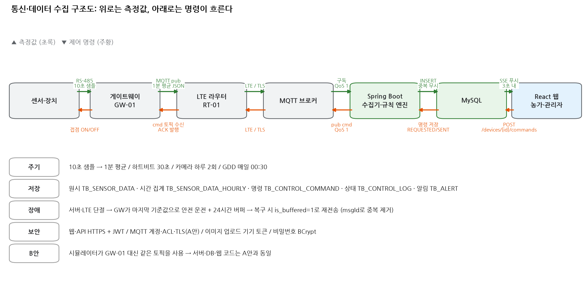

| 토픽 | 방향 | QoS·retained | 내용 |
|---|---|---|---|
| `todak/{farm}/{zone}/sensor/{code}` | GW → 서버 | 1 | 1분 평균 측정값 (msgId, ts, value, min, max, samples, buffered) |
| `todak/{farm}/gw/{gw}/status` | GW → 서버 | 1, retained, LWT=offline | 30초 하트비트 |
| `todak/{farm}/gw/{gw}/config` | 서버 → GW | 1, retained | 기준값·안전 규칙 사본 (단절 시 GW 안전 운전용) |
| `todak/{farm}/device/{code}/cmd · ack · state` | 양방향 | 1 | 명령, 실행 확인, 현장 변경 |
| `todak/{farm}/sim/scenario` | 서버 → 시뮬레이터 | 1 | B안 시나리오 (관리자 화면) |

MQTT가 끊기면 게이트웨이는 `POST /api/ingest/sensor-data`(기기 토큰)로 올릴 수 있습니다 (API-26).

## 8. 센서 배치도

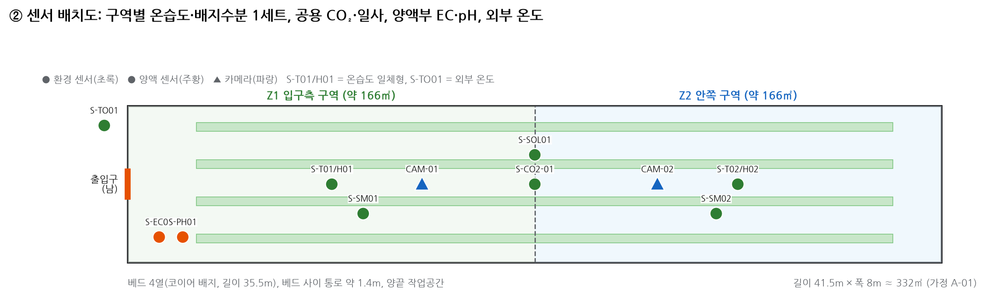
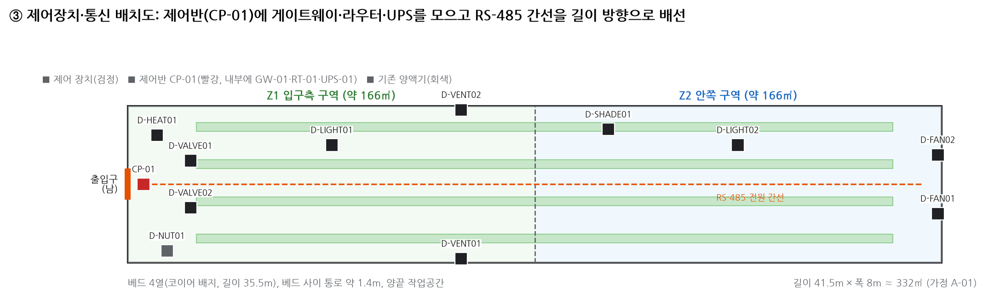

센서 11채널(S-T01·T02, S-H01·H02, S-CO2-01, S-SOL01, S-SM01·SM02, S-EC01, S-PH01, S-TO01)과 장치 11종(측창 2, 환기팬 2, 난방기, 차광막, 보광등 2, 관수 밸브 2, 양액기)은 시드 데이터(`V2__seed.sql`)와 배치도가 같습니다.

## 9. ERD

실제 DDL에서 만든 ERD: [`docs/Diagrams/erd.mmd`](docs/Diagrams/erd.mmd) (22개 테이블, FK 36개). GitHub에서 Mermaid로 보입니다. 테이블 정의는 [`V1__schema.sql`](backend/src/main/resources/db/migration/V1__schema.sql)·[`V3__plan_alignment.sql`](backend/src/main/resources/db/migration/V3__plan_alignment.sql) 주석에 있습니다.

| 영역 | 테이블 |
|---|---|
| 사용자·권한 | TB_USER, TB_USER_FARM, TB_REFRESH_TOKEN |
| 농장·구역·설비 | TB_FARM, TB_ZONE, TB_GATEWAY, TB_SENSOR, TB_DEVICE |
| 측정 | TB_SENSOR_DATA(1분 원시), TB_SENSOR_DATA_HOURLY(시간 집계) |
| 제어 | TB_CONTROL_RULE, TB_CONTROL_COMMAND, TB_CONTROL_LOG |
| 재배·분석 | TB_CROP_CYCLE, TB_CROP_STD(버전), TB_GDD_DAILY, TB_WEATHER_DAILY, TB_BEEHIVE, TB_IMAGE_RESULT(확장) |
| 알림·이력 | TB_ALERT, TB_ALERT_DELIVERY, TB_SETTING_HISTORY |

## 10. 관리자·사용자 대시보드 미리보기

아래는 **실제로 실행한 화면**을 헤드리스 Chromium으로 찍은 것입니다 (`tools/capture_screens.py`, 촬영 시각은 [`CAPTURED_AT.txt`](docs/Test_Evidence/screenshots/CAPTURED_AT.txt)). 값은 시뮬레이션 데이터입니다.

| 로그인 | 회원가입 | 관리자 대시보드 |
|---|---|---|
| 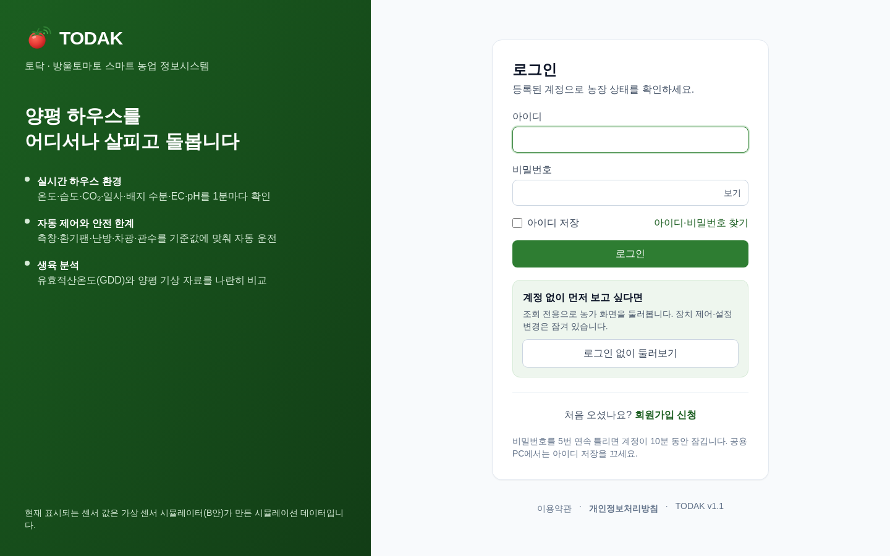 | 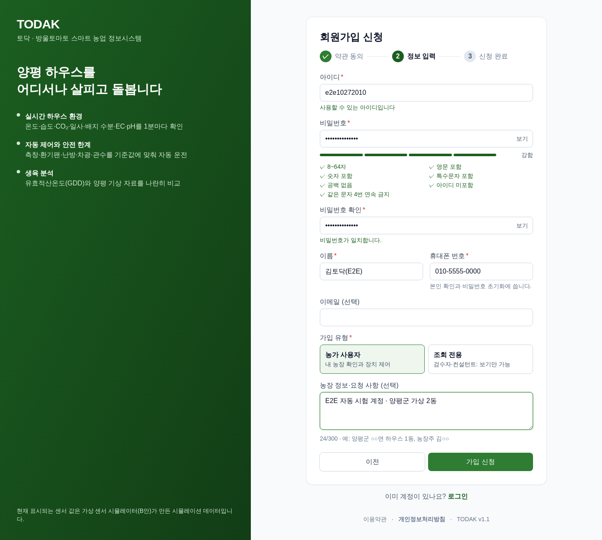 | 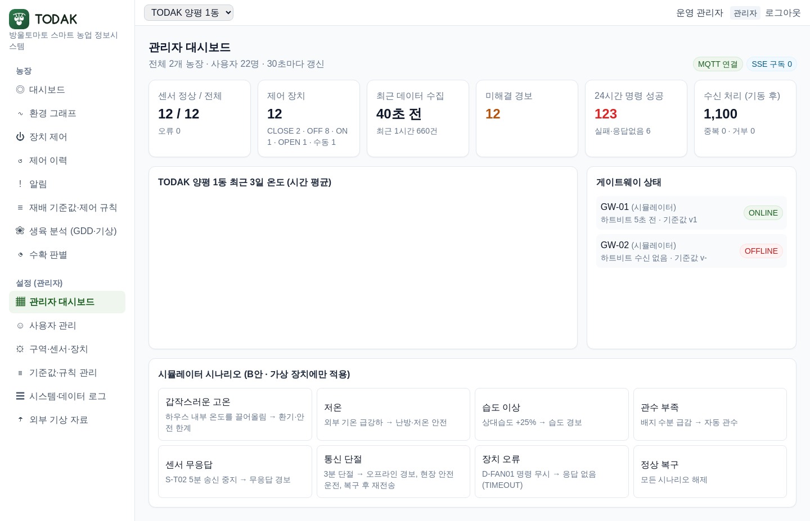 |
| **농가 대시보드** | **생육 분석·GDD** | **모바일 360px** |
| 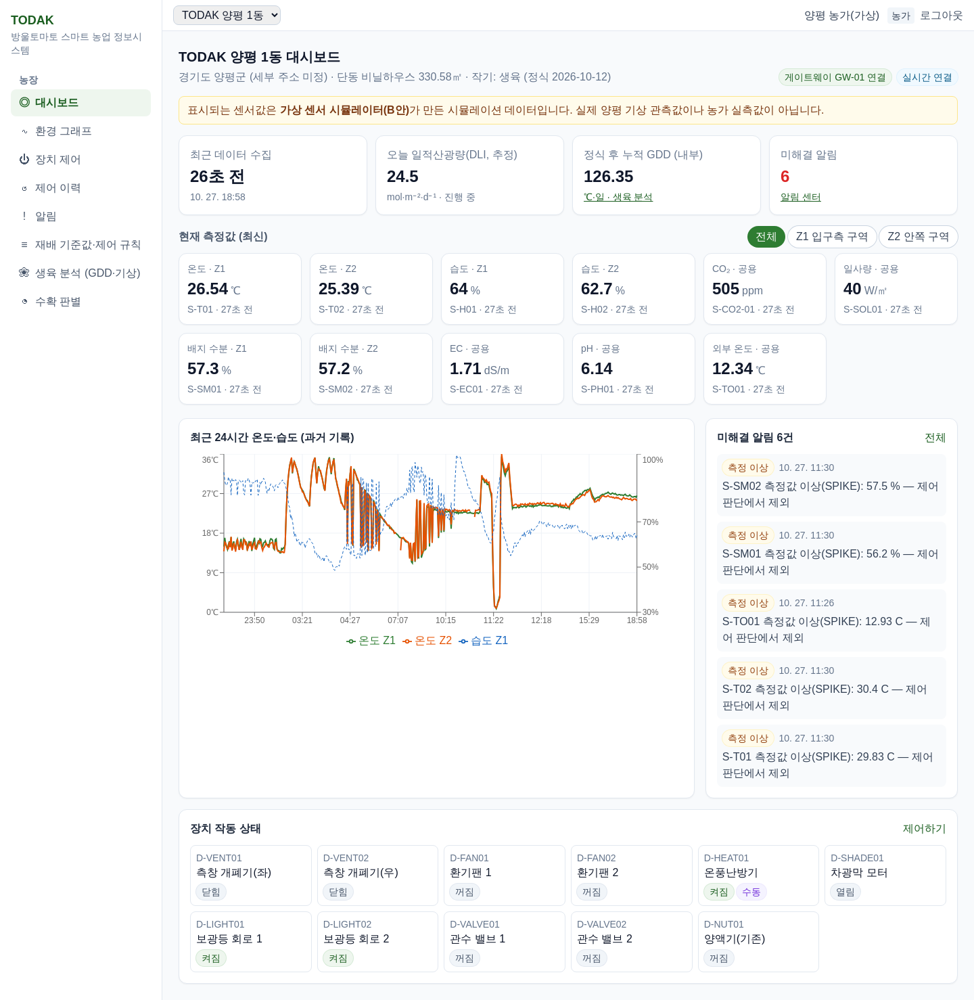 | 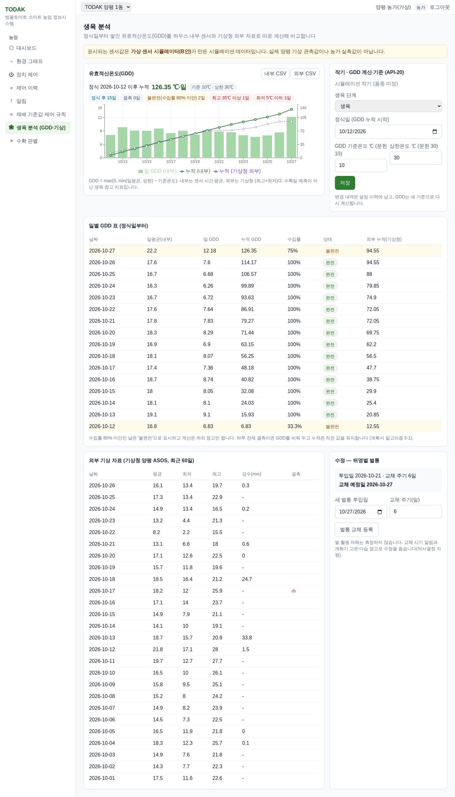 | 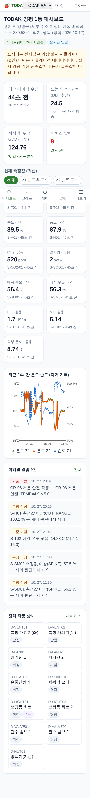 |

## 11. 설치 방법

필요: **Docker Desktop**(Compose v2), Git. Java·Node·MySQL을 따로 설치하지 않아도 됩니다.

```bash
git clone https://github.com/jiwon2324/TODAK-SmartFarm.git
cd TODAK-SmartFarm
cp .env.example .env    # 그다음 .env의 비밀번호·JWT 키를 바꾼다 (13절)
docker compose up -d --build
```

처음 실행은 이미지 내려받기·빌드로 5~10분 걸립니다. 준비되면 http://localhost:8088 에 접속합니다.

## 12. 데이터베이스 설정

- 컨테이너 `mysql` (MySQL 8.4), 호스트 포트 **3307** → 컨테이너 3306. DB 이름 `todak`, 계정 `todak`(비밀번호는 `.env`의 `DB_PASSWORD`).
- 스키마·시드는 백엔드가 시작할 때 **Flyway가 자동 적용**합니다 (`V1__schema.sql` → `V2__seed.sql` → `V3__plan_alignment.sql`).
- 통합 테스트용 DB `todak_test`는 `infra/mysql/init/01-test-db.sql`이 처음 실행 때 만듭니다.
- **MySQL Workbench 접속**: Hostname `127.0.0.1`, Port `3307`, Username `todak`, Password = `.env`의 `DB_PASSWORD`, Default Schema `todak`. 예: `SELECT * FROM TB_SENSOR_DATA ORDER BY data_id DESC LIMIT 20;`
- 백업: `tools/backup-db.sh` (일 1회 cron 권장, 7일 보관). 원시 1분 데이터는 매일 03:00 보존 기간(기본 3년)이 지나면 삭제됩니다.

## 13. 환경 변수 설정

`.env`는 Git에 올리지 않습니다(`.gitignore`). `.env.example`을 복사해 값을 바꿉니다.

| 변수 | 설명 |
|---|---|
| `MYSQL_ROOT_PASSWORD`, `DB_NAME`, `DB_USER`, `DB_PASSWORD` | MySQL 계정 |
| `MYSQL_HOST_PORT` | 호스트에서 쓰는 MySQL 포트 (기본 3307) |
| `JWT_SECRET` | JWT 서명 키, 32바이트 이상 무작위 문자열 (`openssl rand -base64 48`) |
| `MQTT_SERVER_PASSWORD`, `MQTT_GW_PASSWORD` | Mosquitto 서버·게이트웨이 계정 비밀번호 |
| `COOKIE_SECURE` | HTTPS로 배포하면 `true` (Refresh 쿠키 Secure 속성) |
| `CORS_ORIGINS` | 허용할 웹 주소 |
| `RULE_INTERVAL_MS`, `STALE_SEC` | 규칙 평가 주기, 센서 무응답 판정(초, 기본 180) |
| `SIM_BACKFILL_DAYS` | 시뮬레이터가 처음 만들 과거 데이터 일수 (기본 14) |

## 14. Docker 실행 방법

```bash
docker compose up -d --build      # 전체 실행
docker compose ps                 # mysql·mosquitto·backend·simulator·frontend 상태
docker compose logs -f backend    # 백엔드 로그
docker compose down               # 중지 (데이터는 볼륨에 남음)
docker compose down -v            # 데이터까지 삭제
```

| 서비스 | 주소 |
|---|---|
| 웹 | http://localhost:8088 |
| Swagger | http://localhost:8088/swagger-ui/index.html |
| 백엔드 직접 | http://localhost:8080 (헬스체크 `/actuator/health`) |
| MySQL | localhost:3307 |

## 15. 관리자·사용자 테스트 방법

**시험용 계정** (시드 데이터, 운영 전에 반드시 바꾸세요)

| 역할 | 아이디 | 비밀번호 | 접근 |
|---|---|---|---|
| 관리자 | `admin` | `Admin!2026` | 전체 농장, 관리자 화면 |
| 농가 | `farmer01` | `Farmer!2026` | TODAK 양평 1동 |
| 농가(격리 검증용) | `farmer02` | `Farmer!2026` | 비교 농가 1동만 |
| 조회 전용(검수자) | `viewer01` | `Viewer!2026` | TODAK 양평 1동, 제어·설정 불가 |

확인 순서 예:
1. `farmer01` 로그인 → 대시보드 구역 탭, 환경 그래프, 생육 분석(GDD), 장치 제어(측창 열기 → 확인창 → 명령 상태가 '실행 확인'으로 바뀜).
2. `/signup`에서 회원가입 → 로그인하면 '승인 대기' 안내 → `admin`으로 사용자 관리 › 가입 승인 대기 › 승인(농장 지정) → 새 계정 로그인.
3. `admin` 관리자 대시보드 › 시뮬레이터 시나리오 '갑작스러운 고온' → 1~3분 안에 경보·환기 명령이 생김.
4. `viewer01` 로그인 → 제어 버튼이 비활성, API로 보내도 403.
5. `farmer02` 로그인 → 양평 1동 데이터가 보이지 않음 (주소를 바꿔도 403).

## 16. API 문서 접근 방법

- Swagger UI: http://localhost:8088/swagger-ui/index.html — 오른쪽 위 **Authorize**에 `POST /api/auth/login`으로 받은 `accessToken`을 넣으면 인증 API를 실행할 수 있습니다.
- 각 API 설명에 요구사항 ID, 관련 테이블, 오류 코드(400·401·403·404·409·423·503)를 적었습니다.
- 계획서 API-01~27과 실제 경로 대응표: [검토서 4장](docs/Development_Plan/계획서_대비_구현_검토.md#4-api-표-6667--계획서-id와-실제-경로).

## 17. 테스트 실행 방법

| 종류 | 명령 | 결과 위치 |
|---|---|---|
| 백엔드 단위·통합 (실제 MySQL) | `bash tools/run-backend-tests.sh` | `backend/build/reports/tests/test/index.html` |
| 프런트 단위·화면 | `cd frontend && npm ci && npm test` | 콘솔 |
| 시뮬레이터 | `cd simulator && python -m pytest -q tests` | 콘솔 |
| E2E (Playwright) | README 아래 명령 | `docs/Test_Evidence/e2e_results.md`, `screenshots/` |
| 시나리오 통합 | `TODAK_ADMIN_PW=... python3 tools/scenario_test.py` (약 45분) | `docs/Test_Evidence/scenario_results.md` |
| 성능 (k6) | `docker run --rm --network todak_default -e PW=... -v "$PWD/tools/perf":/s grafana/k6:0.54.0 run /s/k6_api.js` | 콘솔 요약 → `docs/Test_Evidence/performance.md` |

```bash
docker run --rm --network todak_default -v "$PWD":/w -w /w \
  -e TODAK_ADMIN_PW='Admin!2026' -e TODAK_FARMER_PW='Farmer!2026' -e TODAK_VIEWER_PW='Viewer!2026' \
  mcr.microsoft.com/playwright/python:v1.48.0-jammy \
  sh -c "pip install -q playwright==1.48.0 && apt-get -qq update && apt-get -qq install -y fonts-nanum && python tools/capture_screens.py"
```

최근 실행 결과는 [시험 결과 요약](docs/Test_Evidence/README.md)에 있습니다.

### 항상 열리는 스냅샷 데모 (GitHub Pages)

- https://jiwon2324.github.io/TODAK-SmartFarm/app/demo — 서버 없이 언제든 열린다. 실제 시스템에서 기록한 API 응답(`tools/snapshot/record.py` → `docs/app/snapshot`)으로 모든 화면을 보여 주고, 장치 제어·설정 변경은 실행하지 않는다.
- 다시 만들기: 시스템을 켠 상태에서 `TODAK_ADMIN_PW=... python3 tools/snapshot/record.py` 후 `VITE_SNAPSHOT=1 VITE_BASE=/TODAK-SmartFarm/app/ npx vite build` 결과를 `docs/app`에 복사(`index.html`을 `404.html`로도 복사)

### 공개 주소로 열기 (가입 없이, 맥북이 켜져 있는 동안)

Cloudflare 임시 터널로 `https://….trycloudflare.com` 주소를 만든다. 주소는 터널을 다시 만들면 바뀐다.

```bash
docker run -d --name todak-web-public --restart unless-stopped --network todak_default -v "$PWD/infra/public/Caddyfile:/etc/caddy/Caddyfile:ro" -v "$PWD/docs/Demo:/srv/video:ro" caddy:2.8-alpine
docker run -d --name todak-tunnel --restart unless-stopped --network todak_default cloudflare/cloudflared:2024.10.1 tunnel --no-autoupdate --url http://todak-web-public:80
docker logs todak-tunnel 2>&1 | grep trycloudflare.com
```

- 로그인 없이 둘러보기: `<주소>/demo` (조회 전용 계정 viewer01, 끄려면 `DEMO_LOGIN_ID=` 빈 값)
- 시연 영상 (항상 열림, GitHub Pages): https://jiwon2324.github.io/TODAK-SmartFarm/Demo/ — 4K 3840×2160 · 50fps
- 같은 영상을 공개 주소에서도: `<주소>/video/TODAK_demo_4K.mp4`
- 클라우드 VM에 상시 배포할 때는 `tools/deploy/deploy_oracle.sh` (HTTPS·포트 차단 포함)

## 18. 산출물 및 보고서 링크

| 산출물 | 위치 |
|---|---|
| **과제 제출본: 시스템 구축 보고서** (제안서+개발 계획서+완료 보고서+배운 점, Word/PPT/PDF) | 과제 폴더 상위 `05_시스템_구축_보고서_v1.0` (`tools/reports/build_integrated.py`로 생성) |
| RFP·개발 계획서·보고서(Word/PPT/PDF) | 과제 폴더 상위 (`01_RFP…`, `02_시스템_개발_계획서_v2.0…`, `03…`, `04…`) |
| 계획서 대비 구현 검토서 | [docs/Development_Plan/계획서_대비_구현_검토.md](docs/Development_Plan/계획서_대비_구현_검토.md) |
| 요구사항 추적 매트릭스(RTM) | [docs/RTM.md](docs/RTM.md) |
| 인수 테스트 체크리스트 | [docs/Test_Evidence/인수테스트_체크리스트.md](docs/Test_Evidence/인수테스트_체크리스트.md) |
| 시험 결과·실행 화면 | [docs/Test_Evidence/](docs/Test_Evidence/) |
| 다이어그램 | [docs/Diagrams/](docs/Diagrams/) |
| 최종 테이블 정의서 (실제 DB에서 추출) | [docs/Database/테이블_정의서.md](docs/Database/테이블_정의서.md) — `python3 tools/db_dictionary.py && python3 tools/erd_from_db.py`로 ERD까지 다시 생성 |

## 19. 기능별 개발 현황

| 상태 | 요구사항 |
|---|---|
| 완료(시뮬레이터로 검증) | F-01~04, F-06, F-08~18, N-03·04(일부)·05·06·07 |
| 확장 범위 · 미구현 | F-05 육묘 모니터링, F-07 수확 판별(카메라·OpenCV), SMS 알림 |
| 운영 환경 필요 · 미측정 | N-02 가용성 99.5%, HTTPS/TLS 배포, 농가 사용성 테스트, Edge·Safari 실기기 |
| 실제 자료 | 기상청 양평 ASOS 일자료 2026-10-01~26 **가져옴** (외부 GDD, `docs/Test_Evidence/kma/`) · 실제 센서·장비(A안)는 대기 |
| 형상 관리 | GitHub 공개 저장소 jiwon2324/TODAK-SmartFarm (2026-10-27 업로드) |

## 20. 향후 개선 계획

1. 실장비(A안) 연결: Modbus 게이트웨이, 전기·설비 안전 검증 후 '알림만' 모드로 1주 시범 운영(계획서 14.1).
2. 수확 판별(F-07): 라벨 이미지 300장 이상 수집 후 OpenCV 착색도 분석 서비스와 API-24·25.
3. HTTPS·MQTT TLS, 운영 서버 배포, 모니터링(가용성 측정).
4. 문자 알림(유료 API), 기상청 API 자동 연동.
5. 목록 API 페이지 응답 형식 통일, 코드 분할로 첫 화면 용량 줄이기.

---
라이선스: 과제용 비공개 프로젝트. 기상 자료는 기상청 기상자료개방포털 이용 조건(출처 표시)을 따릅니다. 시드 데이터의 농가·인물은 모두 가상입니다.
