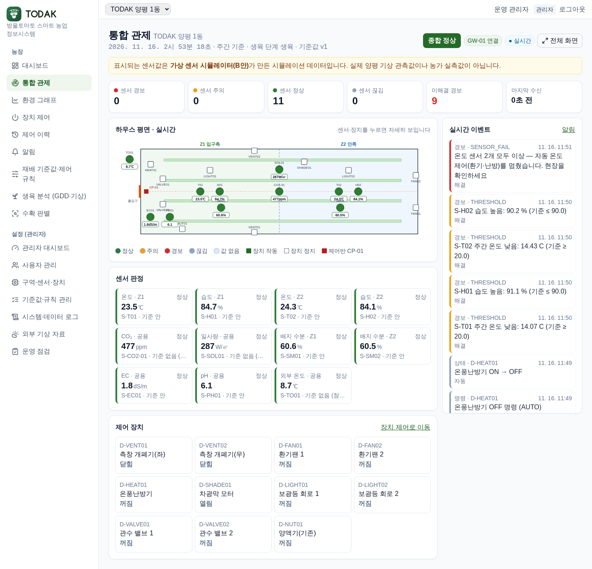

# 바이브 코딩: 스마트팜 관제 소프트웨어 만들기 v1.0

## 1. 개요

### 1.1 목적

메모의 '바이브 코딩' 항목 — "스마트 Farm의 관제 소프트를 만들어 봅니다. → 일단 시작. 그런데 궁금한 것들 → 어떤 Framework을 사용하는 것일까?" — 을 실제로 해 본 기록이다. 무엇을 만들었는지, 바이브 코딩으로 어떻게 진행했는지, 궁금했던 '어떤 Framework을 쓰는가'에 답한다.

### 1.2 구성

| 장 | 내용 |
|---|---|
| 2장 | 만든 것: 스마트팜 관제 소프트웨어(통합 관제 화면) |
| 3장 | 바이브 코딩으로 시작하기: 진행 순서, 확인 방법, 알게 된 점 |
| 4장 | 어떤 Framework을 사용하는가: 계층별 기술·버전·역할, 데이터가 지나가는 길, 계획 대비 바뀐 선택 |
| 5장 | 다음에 궁금한 것 |
| 6장 | 결론 |

### 1.3 시스템 바로가기

| 항목 | 주소 |
|---|---|
| 관제 소스 코드 (운영 이관 브랜치) | https://github.com/jiwon2324/TODAK-SmartFarm/tree/ops-handover |
| 관제 화면 코드 | https://github.com/jiwon2324/TODAK-SmartFarm/blob/ops-handover/frontend/src/pages/monitor/Monitor.tsx |
| 관제 API 코드 | https://github.com/jiwon2324/TODAK-SmartFarm/blob/ops-handover/backend/src/main/java/kr/todak/web/MonitorController.java |
| 웹 사이트 — 로그인 없이 둘러보기 (스냅샷 데모) | https://jiwon2324.github.io/TODAK-SmartFarm/app/demo |
| 시연 영상 | https://jiwon2324.github.io/TODAK-SmartFarm/Demo/ |
| 관제 화면 직접 실행 | `docker compose up -d` 뒤 http://localhost:8088/monitor |

## 2. 만든 것: 스마트팜 관제 소프트웨어

TODAK 웹에 **통합 관제** 화면(`/monitor`, SCR-M1)을 더했다. 제출한 PPT의 센서 배치도·제어장치 배치도를 그대로 옮긴 하우스 평면 위에, 센서 11개의 현재 값과 판정, 장치 11개의 작동 상태, 경보·제어 명령·상태 변경 이벤트를 실시간으로 겹쳐 보여 준다.

| 구성 | 내용 |
|---|---|
| 화면 | 상단 상태줄(시각·주야간·생육 단계·종합 판정·게이트웨이·실시간 연결), 판정 요약, 하우스 평면, 센서 판정 카드, 장치 상태, 실시간 이벤트, 전체 화면 |
| 판정 | 서버가 계산: 정상(기준 안) · 주의(재배 기준 이탈) · 경보(안전 한계 35℃·5℃ 또는 품질 이상) · 끊김(3분 수신 없음) · 값 없음 |
| 실시간 | 새 측정값·장치 상태·명령·경보를 SSE로 받아 바로 반영, 판정은 3초 안에 서버에서 다시 받음 |
| 근거 요구사항 | REQ-F-01 수집, F-06·F-09 경보, F-08 원격 제어 상태, F-18 실시간 갱신 (PPT 02 개발 계획서) |
| 코드 | 화면 `frontend/src/pages/monitor/Monitor.tsx`(320줄), 배치 좌표 `layout.ts`(47줄), API `backend/.../web/MonitorController.java`(204줄) |

## 3. 바이브 코딩으로 시작하기

### 3.1 바이브 코딩이란

코드를 한 줄씩 직접 쓰는 대신, 만들고 싶은 것을 말로 설명하고 AI 코딩 도구(이번에는 Claude Code)가 코드를 쓰게 하는 방식이다. 사람은 **무엇을 만들지 정하고, 결과가 맞는지 확인하는 일**을 맡는다. 이번 관제 소프트웨어는 아래 순서로 만들었다.

### 3.2 실제 진행 순서

| 단계 | 사람이 한 말·결정 | AI가 한 일 | 확인 방법 |
|---|---|---|---|
| 1. 시작 | 메모 사진을 주고 "이 내용으로 만들어야 돼" | 저장소를 읽고, 이미 있는 것(관리자 사이트)과 없는 것(운영 매뉴얼·설치 보고서·GA4)을 구분해 범위를 물어봄 | 사람이 4가지 모두 선택, 문서 형식은 Word + md |
| 2. 기준 세우기 | "제출한 PPT의 소프트웨어 아키텍처를 그리고 그걸 기반으로 만들어줘" | PPT 5개에서 아키텍처 슬라이드를 찾아 계층별 구조도로 다시 그림 | 그림을 보고 겹친 화살표·글자를 고침 |
| 3. 관제 요청 | "PPT 보고서를 기반으로 관제 시스템도 넣어줬어? (코드를 짜줘야 함)" | PPT에 '관제'라는 말은 없지만 같은 요구사항(F-01·06·08·09·18)과 배치도를 찾아 근거로 삼음 | 없던 기능이라고 먼저 사실대로 답함 |
| 4. 설계 | - | 판정은 서버 한 곳에서(기존 경보·자동 제어와 같은 기준), 화면은 그리기만 하도록 나눔 | 기존 `ThresholdEvaluator`·안전 규칙(CR-05·06)과 기준을 맞춤 |
| 5. 구현 | - | 관제 API → 통합 시험 → 화면(SVG 평면) → 단위 시험 순서로 작성 | 백엔드 시험 80건, 프런트 시험 18건 통과 |
| 6. 실제로 보기 | - | 시스템을 띄우고 브라우저에서 관제 화면을 열어 봄 | 평면 위 센서 값 상자가 겹친 것을 발견 → 좌표 수정 |
| 7. 상황 만들어 보기 | - | 시뮬레이터 '갑작스러운 고온' 시나리오 실행 → 정상 복구 | 온도 센서가 빨간 경보로 바뀌고 경보가 이벤트 목록에 바로 뜨는 것 확인 |
| 8. 문서 반영 | "Commit and push" | 아키텍처 그림·운영 매뉴얼 4.4절·README 갱신 후 커밋 | GitHub `ops-handover` 브랜치 |

### 3.3 해 보니 알게 된 것

- **AI가 쓴 글도 코드와 대조해야 한다.** 운영 매뉴얼 초안에 '센서 상태를 점검 중으로 바꾼다', '변경 사유를 입력한다'라고 썼지만 실제 화면에는 그런 기능이 없었다. 코드를 확인해 '폐기(RETIRED)', '점검표 비고에 적는다'로 고쳤다.
- **직접 설치해 봐야 보이는 결함이 있다.** 새 환경에 설치하자 서버가 켜질 때 MQTT 연결보다 기준값 발행이 먼저 실행되는 순서 문제와, 연결된 적 없는 게이트웨이를 장애로 세는 문제가 드러났다. 시험은 모두 통과하던 상태였다.
- **화면은 눈으로 봐야 한다.** 시험은 통과했지만 브라우저에서 보니 같은 함체의 온도·습도 값 상자가 겹쳐 있었다.
- **결정은 사람이 한다.** 무엇을 만들지(범위), 어느 PPT를 기준으로 할지, 기말고사 대체과제로 표기할지, 언제 커밋할지는 모두 사람이 정했다.

## 4. 그런데 궁금한 것: 어떤 Framework을 사용하는 것일까?

### 4.1 Framework와 라이브러리

- **Framework**: 프로그램의 뼈대와 실행 흐름을 정해 주고, 개발자는 정해진 자리에 코드를 끼워 넣는다. 예: Spring Boot가 서버를 띄우고 요청을 받으면 우리가 쓴 `MonitorController.monitor()`를 불러 준다.
- **라이브러리**: 필요할 때 우리 코드가 불러 쓰는 도구 묶음. 예: Recharts(그래프), Paho(MQTT 통신).

### 4.2 계층별로 쓰는 것

| 계층 | 이름 | 버전 | 종류 | 하는 일 | 관제에서 쓰인 곳 |
|---|---|---|---|---|---|
| 화면 | React | 18.3.1 | UI 라이브러리(사실상 화면 프레임워크) | 화면을 컴포넌트로 나눠 그림, 상태가 바뀌면 다시 그림 | Monitor·HouseMap 컴포넌트, 실시간 값 상태 |
| 화면 | TypeScript | 5.6 | 언어 | 자바스크립트에 타입 검사 추가 | 판정 단계 `Level` 타입, API 응답 형태 |
| 화면 | Vite | 5.4.8 | 빌드 도구 | 개발 서버·배포용 번들 생성 | 관제 화면 빌드 |
| 화면 | Tailwind CSS | 3.4.13 | CSS 프레임워크 | 클래스 이름으로 디자인·반응형 | 카드·배지·휴대폰 360px 배치 |
| 화면 | React Router | 6.26.2 | 라이브러리 | 주소(`/monitor`)별 화면 연결 | 관제 메뉴·경로 |
| 화면 | Recharts | 2.12.7 | 차트 라이브러리 | 그래프 | 관제에서는 안 씀 (평면은 SVG 직접) |
| 화면 | lucide-react | 0.454.0 | 아이콘 | 선 아이콘 | 메뉴 '통합 관제' 레이더 아이콘, 전체 화면 버튼 |
| 서버 | Spring Boot | 3.3.5 | **백엔드 프레임워크** | 서버 실행, REST API, 설정, 스케줄 작업 | `GET /api/farms/{id}/monitor` |
| 서버 | Java | 21 | 언어 | 서버 코드 | 판정 로직(record·switch) |
| 서버 | Spring Security + jjwt | 6 · 0.12.6 | 보안 프레임워크 | 로그인 토큰(JWT) 검사, 권한 | 다른 농장 관제 화면 403 |
| 서버 | Spring Data JPA (Hibernate) | Boot 3.3 포함 | ORM 프레임워크 | DB 표를 자바 객체로 다룸 | 최신 측정값·경보·명령 조회 |
| 서버 | Spring SseEmitter | Boot 3.3 포함 | Spring 기능 | 서버 → 브라우저 실시간 이벤트(SSE) | 새 측정값·장치 상태 푸시 |
| 서버 | Flyway | Boot 3.3 포함 | DB 이력 관리 | 테이블 만들기·변경을 순서대로 적용 | 관제는 새 테이블 없이 기존 22개 사용 |
| 서버 | springdoc-openapi | 2.6.0 | 라이브러리 | API 문서(Swagger) 자동 생성 | 관제 API가 '관제' 묶음으로 문서화 |
| 통신 | Eclipse Paho (Java) | 1.2.5 | MQTT 라이브러리 | 서버가 MQTT로 측정값 받기·명령 보내기 | 관제에 보이는 값의 출처 |
| 통신 | Eclipse Mosquitto | 2.0.20 | MQTT 브로커 | 게이트웨이와 서버 사이 메시지 전달 | - |
| 현장 | Python + paho-mqtt | 3.12 · 2.1.0 | 언어·라이브러리 | 가상 센서·장치 시뮬레이터 | 고온 시나리오 시험 |
| DB | MySQL | 8.4 | 데이터베이스 | 측정값·경보·명령 저장 | - |
| 실행 | Docker Compose · nginx | - · 1.27 | 실행 환경 | 컨테이너 5개 실행, 웹 배포·/api 전달 | - |
| 시험 | JUnit 5 · Vitest · Playwright | Boot 포함 · 2.1.2 · 1.48 | 시험 프레임워크 | 서버 통합 시험, 화면 단위 시험, 브라우저 자동 조작 | 관제 시험 5건, 관제 화면 캡처 |

### 4.3 관제 화면 한 번 갱신될 때 거치는 길

1. 시뮬레이터(Python, paho-mqtt)가 1분마다 측정값을 MQTT로 보낸다 → Mosquitto.
2. 서버(Spring Boot)의 Paho 어댑터가 받아 검증하고 JPA로 MySQL에 저장한다.
3. 저장과 동시에 SseEmitter가 브라우저로 `reading` 이벤트를 보낸다.
4. 브라우저(React)의 `EventSource`가 받아 평면 위 값을 바로 바꾼다.
5. 3초 뒤 React가 `/api/farms/1/monitor`를 부르면, Spring MVC → `MonitorController`가 재배 기준값·안전 규칙으로 판정해 돌려준다.
6. React가 판정 색·깜빡임을 SVG로 다시 그린다.

### 4.4 계획서와 달라진 선택과 이유 (PPT 03 개발 보고서 7쪽)

| 영역 | 계획서 | 실제 | 이유 |
|---|---|---|---|
| 화면 디자인 | MUI | Tailwind CSS | 후속 지시서가 Tailwind 지정 |
| 서버 언어 | Java 17 | Java 21 | 최신 LTS |
| MQTT 연동 | Spring Integration MQTT | Eclipse Paho 직접 사용 | 의존성 단순화, 재연결 때 수신 처리 스레드를 따로 둠 |
| 시험 | Mockito 위주 | 실제 MySQL 통합 시험 + Playwright E2E | 실제 DB·화면으로 확인 |

### 4.5 관제를 만들면서 새 Framework을 넣지 않은 이유

- **평면도는 SVG로 직접 그렸다.** 지도·도면 라이브러리를 넣지 않아도 PPT 배치도의 좌표(백분율) 22개면 충분했고, 의존성이 늘지 않는다.
- **실시간은 기존 SSE를 다시 썼다.** 서버 → 화면 한 방향이면 되므로 WebSocket이 필요 없었고, 대시보드가 이미 쓰는 연결과 권한 검사를 그대로 쓴다.
- **판정은 서버 한 곳에서만 한다.** 자동 제어·경보와 관제 화면이 서로 다른 기준을 쓰는 일을 막기 위해서다.

## 5. 다음에 궁금한 것

| 질문 | 지금 상태 | 다음 단계 |
|---|---|---|
| 실제 장비를 붙이면 관제는 그대로인가? | 같은 MQTT 토픽·JSON이면 서버·화면은 그대로 | A안 게이트웨이 연동 시 배치 좌표만 현장 실측으로 바꿈 |
| 농장이 늘면 평면도는? | 배치 좌표가 코드(`layout.ts`)에 있음 | 좌표를 DB(센서·장치 위치 칸)로 옮기고 관리자 화면에서 편집 |
| 관제 화면 사용량은? | GA4가 화면 이동(page_view `/monitor`)을 기록 | GA4 측정 ID 발급 후 관제 화면 이용 시간 확인 |
| 휴대폰 알림은? | 웹 화면·경보 목록만 | 문자·푸시 알림(확장 계획) |

## 6. 결론

메모의 '스마트 Farm 관제 소프트를 만들어 봅니다'는 PPT에 이미 있던 요구사항(실시간 수집·경보·원격 제어·실시간 갱신)과 배치도를 근거로 **통합 관제 화면과 관제 API**로 완성했다. 바이브 코딩은 말로 설명해 코드를 빨리 얻는 방법이지만, 이번에 실제로 효과가 있었던 것은 **사람이 범위를 정하고, 시험·설치·화면으로 결과를 확인한 단계**였다. AI가 쓴 매뉴얼 문구의 오류, 설치 때만 보이던 기동 순서 결함, 겹친 화면 글자는 모두 그 확인 단계에서 찾았다.

'어떤 Framework을 사용하는가'에 대한 답은 **화면은 React(+TypeScript·Tailwind), 서버는 Spring Boot(+Security·JPA·SSE), 통신은 MQTT(Mosquitto·Paho)** 이다. 관제 소프트웨어는 새 Framework을 더하지 않고 이미 있던 구조 위에 만들었기 때문에, 판정 기준이 자동 제어·경보와 같고 의존성도 늘지 않았다.
