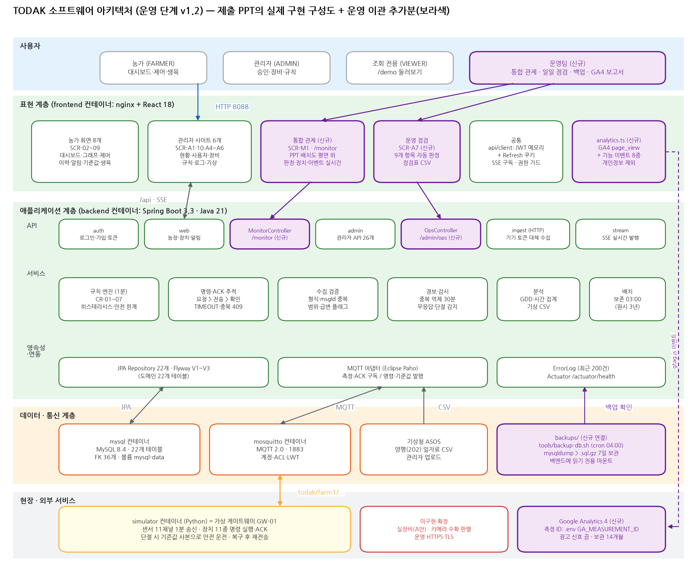
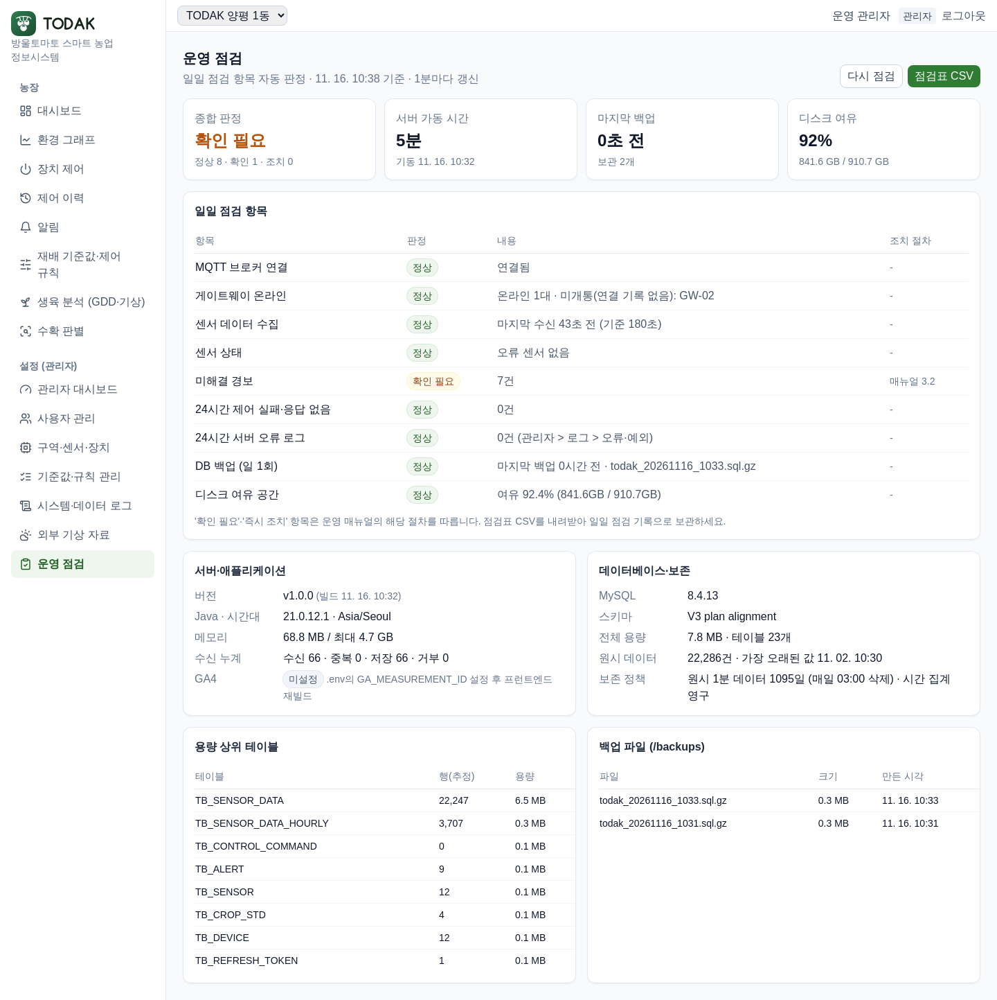

# TODAK 설치 보고서 v1.0

> 운영팀 이관을 위해 깨끗한 환경에 TODAK v1.2.0을 처음부터 설치하고, 설치 결과를 실제 명령 출력으로 확인한 기록이다.
> 설치 일시 2026-11-16 10:27:46 ~ 10:29:03 (KST) · 설치 장소: 개발 PC(아래 2장) — **운영 서버 설치가 아니다.** 운영 서버에서는 같은 절차를 다시 밟고 6장 표를 채운다.
> 원본 출력: docs/Test_Evidence/install/ (compose_up.log, verify_first.log, verify_after_fix.log, 화면 4장)

## 1. 설치 개요

| 항목 | 내용 |
|---|---|
| 설치 대상 | TODAK v1.2.0 (저장소 커밋 366feb1 + 운영 이관 변경분: 운영 점검 화면·API, GA4 연동, 백업 폴더 연결, MQTT 시작 순서 수정) |
| 설치 방식 | Docker Compose, 컨테이너 5개. 기존 개발용 DB를 건드리지 않도록 별도 폴더·별도 프로젝트 이름(`COMPOSE_PROJECT_NAME=todakinstall`)·새 볼륨으로 설치 |
| 비밀값 | `.env.example`을 복사한 뒤 DB·MQTT·JWT 비밀값 5개를 무작위 값(`secrets.token_urlsafe`)으로 교체 |
| 결과 | 설치 성공, 확인 항목 15개 중 14개 통과, 1개(GA4 실제 수집)는 측정 ID가 없어 미확인. 설치 중 발견한 결함 2건은 수정 후 재확인 (7장) |

## 2. 설치 환경

| 항목 | 값 |
|---|---|
| 하드웨어 | Apple M3 Pro, CPU 12코어, 메모리 18GB |
| OS | macOS 15.5 (24F74) |
| Docker | Engine 29.7.2, Compose v5.5.0 |
| 디스크 | 910.7GB 중 여유 92.5% (설치 직후 운영 점검 화면 값) |
| 네트워크 | 로컬 (localhost) — 외부 공개 없음 |

운영 서버 권장 사양(농장 1~2곳 기준): 2 vCPU, 메모리 4GB 이상, 디스크 40GB 이상, Linux(Ubuntu 22.04 이상) + Docker Engine·Compose v2. 설치된 이미지 크기는 backend 594MB, simulator 217MB, frontend 77.5MB이고 MySQL 데이터는 설치 직후 7.8MB(14일 백필 포함)다.

## 3. 설치 구성



| 컨테이너 | 이미지 | 포트 (호스트:컨테이너) | 볼륨 |
|---|---|---|---|
| frontend | nginx 1.27 + React 빌드 | 8088:80 | - |
| backend | Spring Boot 3.3 (Java 21) | 8080:8080 | ./backups:/backups (읽기 전용) |
| mysql | mysql:8.4 | 3307:3306 | mysql-data, ./infra/mysql/init |
| mosquitto | eclipse-mosquitto:2.0.20 | 1883:1883 | mosquitto-data, ./infra/mosquitto |
| simulator | Python 3.12 (가상 게이트웨이 GW-01) | - | - |

## 4. 사전 준비

1. Docker Engine과 Docker Compose를 설치하고 `docker version`으로 확인한다.
2. 소스를 받는다: `git clone https://github.com/jiwon2324/TODAK-SmartFarm.git`
3. 포트 8088·8080·3307·1883이 비어 있는지 확인한다 (`lsof -i :8088` 등).
4. `.env`를 만든다: `cp .env.example .env` 후 `change-me`로 시작하는 값을 모두 무작위 값으로 바꾼다. GA4를 쓸 경우 `GA_MEASUREMENT_ID`를 넣는다 (운영 매뉴얼 8.1).

## 5. 설치 절차 (실제로 실행한 명령)

```
cp .env.example .env                 # 비밀값 5개 무작위 교체
export COMPOSE_PROJECT_NAME=todakinstall   # 이번 설치만: 개발용 스택과 분리 (운영 서버에서는 생략)
docker compose up -d --build         # 1분 17초 (10:27:46 → 10:29:03)
docker compose ps                    # 5개 Up, backend·mysql healthy
sh tools/backup-db.sh                # 첫 백업
```

컨테이너 시작 순서는 Compose가 지킨다: mysql(healthy) → backend(healthy) → simulator, frontend는 backend 시작 뒤. 이번 PC에는 이전 빌드의 Docker 층 캐시(의존성 내려받기 단계 13개)가 남아 있어 1분 17초가 걸렸다. 캐시가 없는 새 서버에서는 Gradle·npm 의존성을 내려받느라 더 오래 걸린다(측정하지 않음).

## 6. 설치 결과 확인

| # | 확인 항목 | 방법 | 기대 | 결과 | 판정 |
|---|---|---|---|---|---|
| 1 | 컨테이너 5개 기동 | `docker compose ps` | 5개 Up, backend·mysql healthy | 5개 Up, backend·mysql (healthy) | 통과 |
| 2 | 백엔드 상태 | `curl localhost:8080/actuator/health` | UP | `{"status":"UP"}` | 통과 |
| 3 | 웹 접속 | `GET http://localhost:8088/` | 200 | 200 | 통과 |
| 4 | 새 화면 경로 | `GET /admin/ops` | 200 | 200 | 통과 |
| 5 | API 문서 | `GET :8080/swagger-ui.html` | 302 → Swagger UI | 302 | 통과 |
| 6 | 관리자 로그인 | `POST /api/auth/login` (admin) | Access Token 발급 | 228자 토큰 발급 | 통과 |
| 7 | DB 스키마 | flyway_schema_history | V1·V2·V3 성공 | V1 schema, V2 seed, V3 plan alignment 모두 success=1 | 통과 |
| 8 | 테이블 수 | information_schema | 22 + Flyway 이력 1 | 23 | 통과 |
| 9 | 센서 데이터 수집 | TB_SENSOR_DATA 건수, 운영 점검 | 시뮬레이터 14일 백필 + 1분 수신 | 22,209건, 마지막 수신 1초 전 | 통과 |
| 10 | 권한 차단 | farmer01로 `GET /api/admin/ops` | 403 | 403 | 통과 |
| 11 | 운영 점검 (최초) | `GET /api/admin/ops` | 9개 항목 판정 | 정상 5 · 확인 2 · 조치 2 (백업 없음, GW-02, 시작 오류 2건 — 7장) | 확인 |
| 12 | 백업 | `sh tools/backup-db.sh` | .sql.gz 생성, 운영 점검 '정상' | todak_20261116_1031.sql.gz (298KB), DB 백업 판정 정상 | 통과 |
| 13 | 복구 시험 | 임시 MySQL에 백업 풀기 (운영 매뉴얼 4.2) | 테이블·데이터 일치 | 테이블 23개, 측정값 22,231건, 사용자 4명(원본 4명), Flyway V3 | 통과 |
| 14 | 운영 점검 (수정 후) | 7장 수정 반영 후 백엔드 재빌드 | 오류 로그 0, 미개통 GW 제외 | 정상 8 · 확인 1 (미해결 경보 7건) · 조치 0 | 통과 |
| 15 | GA4 | 측정 ID를 넣어 빌드, 빼고 빌드 | 넣으면 번들에 ID·gtag.js, 빼면 불러오지 않음 | 번들 확인 통과. 실제 GA4 속성으로의 수집은 측정 ID가 없어 **미확인** | 일부 |

미해결 경보 7건은 시뮬레이터가 과거 14일을 채우면서 낸 기준 이탈 경보로, 설치 결함이 아니다(운영 매뉴얼 3.2절로 처리).

화면 확인 (헤드리스 Chromium, 1440px·360px):



| 화면 | 결과 |
|---|---|
| 운영 점검 (PC 1440px) | 9개 항목·서버·DB·백업 표시, 가로 넘침 없음 (scrollWidth 1440) |
| 운영 점검 (휴대폰 360px) | 가로 넘침 없음 (scrollWidth 360) |
| 관리자 메뉴 | 설정(관리자) 아래 '운영 점검' 추가 |
| 개인정보처리방침 | 6항 '이용 통계 수집 (Google 애널리틱스 4)' 표시 |

자동 시험(설치 소스와 같은 코드): 백엔드 78건 통과(운영 점검 통합 시험 4건 포함, 실제 MySQL), 프런트엔드 15건 통과(GA4 시험 4건 포함).

## 7. 설치 중 발견한 문제와 조치

| # | 발견 | 원인 | 조치 | 재확인 |
|---|---|---|---|---|
| 1 | 백엔드 기동 직후 오류 로그 2건: "기준값 발행 실패 … this.client is null" | 기동 완료 이벤트에서 기준값 발행(GatewayService)이 MQTT 연결(PahoMqttGateway)보다 먼저 실행될 수 있음 — 순서가 정해져 있지 않았음 | MQTT 연결을 가장 먼저, 기준값 발행을 가장 나중에 실행하도록 순서 지정, 연결 전 발행 시 명확한 오류 문구 | 재빌드 후 오류 로그 0건 (확인 #14) |
| 2 | 운영 점검이 GW-02를 '즉시 조치'로 판정 | 농장 2(격리 검증용)의 GW-02는 연결된 적이 없는 게이트웨이인데 오프라인으로 셈 | 연결 기록이 없는 게이트웨이는 '미개통'으로 표시하고 장애에서 제외 (통합 시험 추가) | 게이트웨이 항목 정상, 내용에 '미개통: GW-02' |
| 3 | 백업 파일 없음 → '즉시 조치' | 새 설치라 백업 전 (정상 동작) | 첫 백업 실행, 운영 서버 cron 등록 필요 | 정상 |

## 8. 남은 일과 제약

| 항목 | 상태 | 다음 단계 |
|---|---|---|
| 운영 서버 설치 | 미실시 (이번은 개발 PC) | 운영 서버에서 4~6장 반복, 6장 표 재작성 |
| HTTPS | 미적용 (HTTP 8088) | 운영 매뉴얼 10.1 — Caddy 등 역방향 프록시, `COOKIE_SECURE=true` |
| 백업 자동화 | 스크립트 동작 확인, cron 미등록 | 운영 서버에 cron 등록 (운영 매뉴얼 4.1) |
| GA4 실제 수집 | 코드·빌드 확인, 측정 ID 미발급 | GA4 속성 생성 → 측정 ID 설정 → 실시간 보고서 확인 |
| 시드 계정 비밀번호 | 공개된 초기값 그대로 | 운영 시작 전 변경 (운영 매뉴얼 10.1) |
| 실장비(A안) | 시뮬레이터(B안)만 연결 | 현장 게이트웨이 연동·안전 검증 후 |
| 통합 관제 화면(SCR-M1) | 이 설치 **뒤에** 추가 — 개발 환경에서 화면·실시간 갱신·고온 시나리오 확인, 통합 시험 2건·단위 시험 3건 통과 | 운영 서버 설치 때 6장 표에 '통합 관제' 항목 추가해 확인 |

## 9. 인수인계 확인

| 구분 | 성명 | 소속·역할 | 확인 내용 | 서명 | 일자 |
|---|---|---|---|---|---|
| 설치 | 양지원 | 개발 | 설치·확인 항목 1~15 수행 | | 2026-11-16 |
| 인수 | | 운영팀 | 운영 매뉴얼 수령, 일일 점검 시연 확인 | | |
| 승인 | | 발주처 | | | |

전달물: 운영 매뉴얼 v1.0, 설치 보고서 v1.0(이 문서), 소프트웨어 아키텍처 그림, `.env` 비밀값(별도 안전한 경로로 전달 — 문서·메신저에 적지 않음), 관리자 계정.
