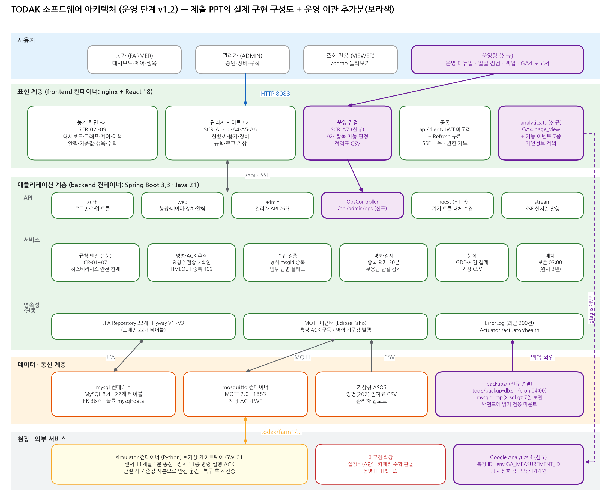
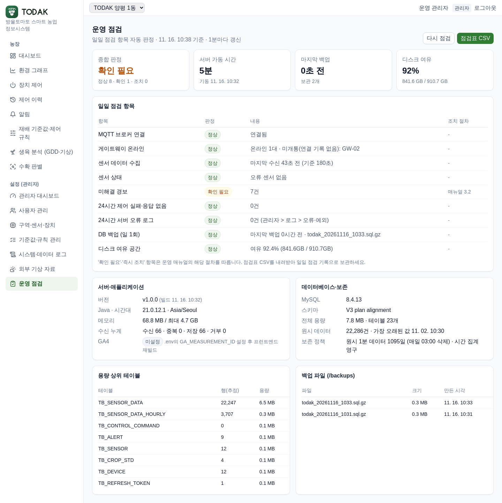

# TODAK 운영 매뉴얼 v1.0

> 대상: TODAK(방울토마토 스마트 농업 정보시스템)을 넘겨받아 운영하는 운영팀 · 시스템 버전 v1.2.0 · 작성일 2026-11-16
> 이 매뉴얼의 절차 번호(3.2, 4.1, 5.2 …)는 관리자 사이트 **운영 점검** 화면(SCR-A7)의 '조치 절차' 칸과 같다.
> 현재 센서·장치는 모두 가상 센서 시뮬레이터(B안)다. 실장비(A안)를 붙이면 5.3·5.5절의 현장 확인 절차가 실제 현장 출동으로 바뀐다.

## 1. 시스템 개요

### 1.1 운영 대상

| 항목 | 내용 |
|---|---|
| 시스템 | TODAK v1.2.0 — 양평 비닐하우스 1동(100평) 환경 수집·자동 제어·경보·원격 제어·생육 분석 |
| 실행 방식 | Docker Compose 컨테이너 5개 (frontend · backend · mysql · mosquitto · simulator) |
| 소스 저장소 | https://github.com/jiwon2324/TODAK-SmartFarm |
| 설치 기록 | 설치 보고서 v1.0 (docs/Operations/설치_보고서.md) |

### 1.2 소프트웨어 아키텍처

제출한 개발·완료·구축 보고서 PPT의 실제 구현 구성도를 계층별로 다시 그리고, 운영 이관에서 더한 부분(운영 점검 화면·운영 점검 API·백업 연결·GA4)을 보라색으로 표시했다.



| 계층 | 구성 요소 | 운영팀이 보는 곳 |
|---|---|---|
| 표현 | React 웹 (농가 화면 8개, 관리자 사이트 7개), GA4 수집 모듈 | 브라우저 http://<서버>:8088 |
| 애플리케이션 | Spring Boot API·규칙 엔진(1분)·명령 ACK 추적·경보·배치 | 관리자 사이트, Swagger http://<서버>:8080/swagger-ui.html |
| 데이터·통신 | MySQL 8.4(22개 테이블), Mosquitto MQTT(1883), 백업 폴더 backups/ | 운영 점검 화면, MySQL Workbench(3307) |
| 현장 | 가상 게이트웨이 GW-01(시뮬레이터), 확장 시 실장비 | 관리자 대시보드 게이트웨이 상태 |
| 외부 | Google Analytics 4 | GA4 콘솔 (analytics.google.com) |

### 1.3 주소와 포트

| 서비스 | 주소 | 비고 |
|---|---|---|
| 웹 (사용자·관리자) | http://<서버>:8088 | /api는 nginx가 백엔드로 넘김 |
| API·Swagger | http://<서버>:8080/swagger-ui.html | 운영 서버에서는 외부 차단 권장 |
| 상태 확인 | http://<서버>:8080/actuator/health | `{"status":"UP"}`이면 정상 |
| MySQL | <서버>:3307 | 계정 `todak`, 비밀번호는 .env |
| MQTT | <서버>:1883 | 계정 `todak-server`, `gw-01` (ACL 적용) |

### 1.4 역할과 계정

| 역할 | 할 수 있는 일 | 비고 |
|---|---|---|
| 관리자 (ADMIN) | 모든 농장, 사용자 승인·권한, 장비·규칙, 로그, 운영 점검 | 운영팀 담당자에게만 발급 |
| 농가 (FARMER) | 배정된 농장의 조회·제어·기준값 | 가입 신청 → 관리자 승인 |
| 조회 전용 (VIEWER) | 배정된 농장 조회만 | 검수자·견학용, /demo |

시드 계정(admin 등)의 초기 비밀번호는 README에 공개되어 있다. **운영 시작 전에 반드시 바꾼다** (10.1절).

## 2. 운영 조직과 연락 체계

| 역할 | 하는 일 | 담당 (운영팀이 채움) |
|---|---|---|
| 운영 관리자 | 일일 점검, 사용자 승인, 경보 확인, 백업 확인 | |
| 시스템 담당 | 장애 대응(5장), 업데이트(9장), 서버·Docker 관리 | |
| 농가 담당 | 농가 문의, 기준값 변경 요청 접수(7장) | |
| 개발 지원 | 결함 수정, 기능 변경 (GitHub 이슈로 요청) | 개발팀 |

장애 등급별 연락 시간:

| 등급 | 예시 | 첫 대응 | 연락 |
|---|---|---|---|
| 1 (긴급) | 수집 전체 중단, MQTT 끊김, 안전 한계 경보가 계속 남 | 30분 안 | 시스템 담당 + 농가 전화 |
| 2 (높음) | 장치 명령 실패 반복, 백업 실패, 디스크 15% 미만 | 4시간 안 | 시스템 담당 |
| 3 (보통) | 센서 1개 오류, 화면 표시 오류 | 다음 근무일 | 운영 관리자 |

## 3. 일상 운영

### 3.1 일일 점검 (매일 09:00, 약 5분)

1. 관리자 계정으로 로그인 → 설정(관리자) → **운영 점검**을 연다.
2. 맨 위 '종합 판정'을 본다. **정상**이면 4번으로, **확인 필요**·**즉시 조치**면 표의 '조치 절차' 번호를 따라간다.
3. 조치를 마친 뒤 **다시 점검**을 눌러 판정이 바뀌었는지 확인한다.
4. **점검표 CSV**를 내려받아 공유 폴더의 `일일점검/YYYY-MM/`에 넣는다 (부록 A 양식과 같은 칸).

운영 점검 화면이 판정하는 9개 항목과 기준:

| 항목 | 정상 | 확인 필요 | 즉시 조치 | 절차 |
|---|---|---|---|---|
| MQTT 브로커 연결 | 연결됨 | - | 끊김 | 5.2 |
| 게이트웨이 온라인 | 모두 온라인 (연결 기록 없는 미개통 게이트웨이는 제외) | - | 연결된 적 있는 게이트웨이가 오프라인 | 5.3 |
| 센서 데이터 수집 | 마지막 수신 180초 이내 | 180~540초 | 540초 초과 또는 데이터 없음 | 5.3 |
| 센서 상태 | 오류(FAULT) 센서 없음 | 오류 센서 있음 | - | 5.4 |
| 미해결 경보 | 0건 | 1건 이상 | - | 3.2 |
| 24시간 제어 실패·응답 없음 | 0건 | 1건 이상 | - | 5.5 |
| 24시간 서버 오류 로그 | 0건 | 1건 이상 | - | 5.6 |
| DB 백업 (일 1회) | 26시간 이내 | 26~52시간, 또는 백업 폴더 미연결 | 52시간 초과, 파일 없음 | 4.1 |
| 디스크 여유 공간 | 15% 이상 | 5~15% | 5% 미만 | 4.3 |



### 3.2 경보 처리

1. 농장 메뉴 → **알림**에서 미해결(OPEN) 경보를 본다.
2. 경보 종류별로 확인한다.
   - 기준 이탈(고온·저온·습도): 대시보드 그래프로 추세를 보고 자동 제어가 작동 중인지 **제어 이력**에서 확인한다. 자동 제어가 돌고 있으면 지켜보고, 30분 넘게 계속되면 농가에 전화한다.
   - 센서 무응답·이상치: 5.4절.
   - 장치 무응답: 5.5절.
   - 통신 장애: 5.3절.
   - 벌통 교체·개화기 고온다습: 농가에 알린다.
3. 확인했으면 **확인(ACK)**, 원인이 없어졌으면 **해결**로 바꾼다. 같은 경보는 30분 동안 다시 만들지 않고 횟수만 늘린다.

### 3.3 주간·월간 점검

| 주기 | 할 일 | 어디서 |
|---|---|---|
| 매주 월 | 가입 대기 사용자 승인·거절 (6.1) | 관리자 → 사용자 관리 |
| 매주 월 | 설정 변경 이력 검토 — 승인 안 된 변경이 없는지 | 관리자 → 로그 → 설정 변경 이력 |
| 매주 월 | GA4 주간 이용 현황 확인 (8.3) | GA4 콘솔 |
| 매월 1일 | 백업 복구 시험 1회 (4.2의 '복구 시험') | 서버 |
| 매월 1일 | 퇴사·계약 종료자 계정 사용 중지 (6.4) | 관리자 → 사용자 관리 |
| 매월 1일 | 기상청 ASOS 양평(202) 지난달 일자료 업로드 | 관리자 → 외부 기상 자료 |
| 분기 | 비밀값 교체 (10.1), Docker 이미지 보안 업데이트 (9장) | 서버 |

## 4. 데이터 관리

### 4.1 백업

- 방식: `tools/backup-db.sh`가 `mysqldump --single-transaction`으로 todak DB 전체를 `backups/todak_YYYYMMDD_HHMM.sql.gz`에 저장하고, 7일 지난 파일을 지운다.
- 백엔드는 `backups/` 폴더를 읽기 전용(`/backups`)으로 보고 운영 점검 화면에 마지막 백업 시각을 표시한다.
- 서버에 cron을 한 번 등록한다 (매일 04:00, 보존 배치 03:00 이후):

```
crontab -e
0 4 * * * /opt/TODAK-SmartFarm/tools/backup-db.sh >> /opt/TODAK-SmartFarm/backups/backup.log 2>&1
```

- 백업이 '확인 필요'·'즉시 조치'일 때: `backups/backup.log`의 마지막 줄을 보고, 손으로 한 번 실행한다 (`sh tools/backup-db.sh`). 디스크가 부족하면 4.3절 먼저.
- 7일 보관은 같은 서버 안의 사본이다. **주 1회 다른 저장소(NAS·클라우드)로 복사**한다.

### 4.2 복구

복구는 현재 DB를 덮어쓴다. 시스템 담당이 하고, 하기 전에 지금 상태를 한 번 더 백업한다.

```
sh tools/backup-db.sh                       # 지금 상태 보관
docker compose stop backend simulator       # 쓰기 중지
gunzip -c backups/todak_20261116_0400.sql.gz | docker compose exec -T mysql sh -c 'mysql -uroot -p"$MYSQL_ROOT_PASSWORD"'
docker compose start backend simulator
```

복구 뒤 운영 점검 화면에서 9개 항목을 다시 확인한다.

**복구 시험(매월)**: 운영 DB를 건드리지 않고 임시 MySQL 컨테이너에 풀어 본다.

```
docker run -d --name todak-restore-test -e MYSQL_ROOT_PASSWORD=restoretest mysql:8.4
gunzip -c backups/<최신 파일> | docker exec -i todak-restore-test mysql -uroot -prestoretest
docker exec todak-restore-test mysql -uroot -prestoretest -e "SELECT COUNT(*) FROM todak.TB_SENSOR_DATA"
docker rm -f todak-restore-test
```

설치 때 이 방법으로 시험해 테이블 23개(22 + Flyway 이력)와 측정값 22,231건이 그대로 복구되는 것을 확인했다 (설치 보고서 6장).

### 4.3 데이터 보존과 디스크

| 데이터 | 보존 | 처리 |
|---|---|---|
| 원시 1분 측정값 (TB_SENSOR_DATA) | 3년 (RAW_RETENTION_DAYS=1095) | 매일 03:00 자동 삭제 |
| 시간 집계·GDD·제어 이력·경보 | 영구 | - |
| DB 백업 | 서버 7일 + 외부 사본 | backup-db.sh |
| 오류 로그 (화면) | 최근 200건, 재시작 시 초기화 | 컨테이너 로그는 `docker compose logs` |
| GA4 이용 통계 | 14개월 | GA4 데이터 보관 설정 |

디스크 여유가 15% 아래로 떨어지면:

1. `docker system df`로 공간을 많이 쓰는 곳을 확인한다.
2. 쓰지 않는 이미지·빌드 캐시를 지운다: `docker image prune -f`, `docker builder prune -f` (볼륨은 지우지 않는다).
3. `backups/`의 오래된 파일이 외부로 복사되었는지 확인하고 정리한다.
4. 그래도 부족하면 디스크 증설을 요청한다. **`docker volume rm`이나 `docker compose down -v`는 DB를 지우므로 쓰지 않는다.**

## 5. 장애 대응

### 5.1 공통 순서

1. 운영 점검 화면에서 어떤 항목이 실패인지 본다.
2. 컨테이너 상태: `docker compose ps` — 모든 서비스가 `Up`, backend·mysql은 `(healthy)`여야 한다.
3. 로그: `docker compose logs --tail=200 <서비스>`
4. 아래 절차로 조치하고, 조치 내용을 일일 점검표 비고에 적는다.
5. 1·2등급은 끝난 뒤 장애 보고(부록 B)를 쓴다.

### 5.2 MQTT 브로커 연결 끊김

- 증상: 운영 점검 'MQTT 브로커 연결' 즉시 조치, 관리자 대시보드 'MQTT 끊김'.
- 확인: `docker compose ps mosquitto`, `docker compose logs --tail=100 mosquitto`.
- 조치: `docker compose restart mosquitto` → 백엔드는 자동 재연결한다(최대 1~2분). 그래도 안 되면 `docker compose restart backend`.
- 영향: 끊긴 동안 게이트웨이는 마지막 기준값 사본으로 현장 안전 운전을 하고, 측정값을 모았다가 재연결 후 다시 보낸다(시나리오 시험으로 확인한 동작).

### 5.3 게이트웨이 오프라인 · 수집 중단

- 증상: '게이트웨이 온라인' 또는 '센서 데이터 수집' 실패, 통신 장애 경보.
- 확인: 관리자 대시보드 게이트웨이 카드의 마지막 하트비트, `docker compose logs --tail=100 simulator`.
- 조치(현재 B안): `docker compose restart simulator`. 시뮬레이터는 재시작하면 빈 구간을 채우지 않는다(실제 공백으로 남김).
- 조치(실장비 A안): 현장 전원·LTE 모뎀 확인 → 농가에 전화해 현장 상태 확인 → 필요 시 현장 출동.
- 참고: 연결 기록이 전혀 없는 게이트웨이(예: 농장 2의 GW-02)는 '미개통'으로 표시되고 장애로 보지 않는다. 설치를 마치면 자동으로 판정에 들어간다.

### 5.4 센서 오류 · 이상치

- 확인: 관리자 → 로그 → 센서 수집 로그에서 해당 센서의 수신률·마지막 수신.
- 조치: 이상치(범위 밖·급변) 경보만 있고 수신이 정상이면 값 추세를 보고 농가에 알린다. 수신이 3분(STALE_SEC, 기본 180초) 넘게 끊긴 센서는 서버가 자동으로 FAULT로 바꾸고 경보를 낸다. 교체·수리를 요청하고, 고쳐서 다시 수신되면 상태가 자동으로 ACTIVE로 돌아온다. 아예 철거한 센서는 관리자 → 구역·센서·장치에서 **폐기**(RETIRED)로 바꿔 감시 대상에서 뺀다(이력은 남음).

### 5.5 제어 실패 · 응답 없음

- 확인: 관리자 → 로그 → 제어 명령 로그에서 FAILED·TIMEOUT 명령의 장치와 사유.
- 조치: 같은 장치가 반복해서 실패하면 그 장치를 **수동** 모드로 바꿔 자동 명령을 멈추고, 농가에 현장 확인을 요청한다. 안전 한계(고온·저온) 규칙이 걸린 장치면 1등급으로 다룬다.
- 시험: B안에서는 관리자 대시보드 시나리오 '정상 복구'로 장치 오류 시나리오를 해제한다.

### 5.6 서버 오류 로그

- 확인: 관리자 → 로그 → 오류·예외 로그. 분류(MQTT·CONFIG·INGEST 등)와 내용을 본다.
- 조치: 같은 오류가 반복되면 `docker compose logs --tail=500 backend > backend_YYYYMMDD.log`로 저장해 개발 지원에 GitHub 이슈로 넘긴다. 일시적인 오류(재연결 직후 1건 등)는 비고에만 적는다.

### 5.7 전체 재시작

정전·서버 재부팅 뒤:

```
cd /opt/TODAK-SmartFarm
docker compose up -d          # 이미지를 다시 만들지 않고 그대로 올림
docker compose ps             # backend·mysql (healthy) 확인
```

1~2분 뒤 운영 점검 화면을 확인한다. Docker가 부팅 때 자동 시작되도록 설정해 둔다.

## 6. 사용자·권한 관리

### 6.1 가입 승인
관리자 → 사용자 관리 → **승인 대기** 목록. 신청자의 이름·연락처를 농가 담당이 전화로 확인한 뒤 역할(농가/조회 전용)과 농장을 골라 **승인**한다. 확인이 안 되면 **거절**.

### 6.2 비밀번호 초기화
사용자가 '비밀번호 찾기'로 요청하면 사용자 목록에 '초기화 요청'이 표시된다. 본인 확인 후 **임시 비밀번호** → **발급** → 전화로 알린다. 사용자는 첫 로그인 때 비밀번호를 반드시 바꾼다. 임시 비밀번호를 문자·메신저에 남기지 않는다.

### 6.3 잠금 해제
5번 연속 실패하면 10분 동안 잠긴다. 10분 뒤 자동으로 풀리며, 급하면 사용자 관리에서 **잠금 해제**를 누른다.

### 6.4 권한 회수·비활성화
농장 배정을 지우면 그 즉시 해당 농장 API가 403으로 막힌다. 퇴사·계약 종료자는 사용자 관리에서 **사용 중지**를 누른다(삭제하지 않음 — 제어 이력의 작업자 기록 보존).

## 7. 설정 변경 관리

- 재배 기준값·제어 규칙은 농가가 요청하고 운영 관리자가 바꾼다. 바꾸기 전에 농가와 값을 함께 확인하고, 요청자·사유를 일일 점검표 비고에 적는다(화면에 사유 입력 칸은 없다).
- 바꾼 값은 새 버전으로 저장되고 게이트웨이에 기준값 사본으로 다시 보내진다. 관리자 대시보드 게이트웨이 카드의 '기준값 v'가 새 버전으로 바뀌었는지 확인한다.
- 안전 한계 규칙(고온·저온)은 한 번에 크게 바꾸지 않는다(2℃ 이내). 실장비 적용 첫 1주는 '알림만' 운영한다.
- 모든 변경은 관리자 → 로그 → 설정 변경 이력에 남는다(누가·언제·무엇을·이전 값).

## 8. 이용 통계 (GA4)

### 8.1 설정

1. Google 애널리틱스에서 속성을 만들고 웹 데이터 스트림을 추가한다 → 측정 ID(`G-XXXXXXXXXX`)를 받는다.
2. 서버의 `.env`에 `GA_MEASUREMENT_ID=G-XXXXXXXXXX`를 넣는다.
3. 프런트엔드를 다시 빌드한다: `docker compose up -d --build frontend` (측정 ID는 빌드할 때 들어간다).
4. 운영 점검 화면 '서버·애플리케이션' 카드의 GA4가 **수집 중**으로 바뀌었는지, GA4 콘솔 '실시간' 보고서에 접속이 보이는지 확인한다.
5. GA4 관리 → 데이터 보관을 **14개월**로, Google 신호 데이터 수집은 **끔**으로 둔다.

측정 ID를 비워 두면 GA4 스크립트를 아예 불러오지 않는다(개발·시험·스냅샷 데모 기본값).

### 8.2 수집하는 이벤트

| 이벤트 | 언제 | 매개변수 |
|---|---|---|
| page_view | 화면 이동마다 | page_path (숫자 ID는 :id로 바꿈), page_title |
| login | 로그인 성공 | method (password·demo) |
| logout | 로그아웃 | - |
| sign_up | 회원가입 신청 완료 | method |
| device_control | 수동 제어 명령 | device_type, action, manual_minutes |
| device_mode_change | 자동·수동 전환 | device_type, mode |
| alert_status_change | 경보 확인·해결 | alert_type, status |
| file_download | CSV 내려받기 | file_name, file_extension |
| simulator_scenario | 관리자 시나리오 실행 | scenario |

사용자 속성은 `user_role`(ADMIN·FARMER·VIEWER) 하나뿐이다. 아이디·이름·연락처·농장 이름은 보내지 않는다. 개인정보처리방침 6항에 수집 사실을 적었다.

### 8.3 보는 법 (주간)

| 알고 싶은 것 | GA4 보고서 |
|---|---|
| 농가가 실제로 많이 보는 화면 | 보고서 → 참여도 → 페이지 및 화면 (page_path) |
| 원격 제어를 얼마나 쓰는지 | 보고서 → 참여도 → 이벤트 → device_control |
| 휴대폰·PC 비율 | 보고서 → 기술 → 기기 카테고리 |
| 역할별 사용 | 탐색 → 자유 형식, 측정기준 user_role (맞춤 측정기준 등록 필요) |

`device_type`, `action`, `alert_type`, `user_role`은 GA4 관리 → 맞춤 정의에 한 번 등록해야 보고서에서 고를 수 있다.

## 9. 배포·업데이트

1. 업데이트 전에 백업한다 (`sh tools/backup-db.sh`).
2. 새 버전을 받는다: `git fetch && git checkout <태그 또는 커밋>`.
3. 바뀐 `.env.example` 항목이 있는지 `git diff <이전>..<새> -- .env.example`로 보고 `.env`에 옮긴다.
4. `docker compose up -d --build` — DB 구조 변경은 백엔드가 기동할 때 Flyway가 자동 적용한다.
5. 운영 점검 화면에서 버전과 스키마(V번호), 9개 항목을 확인한다.
6. 문제가 있으면 되돌린다: 이전 커밋으로 `git checkout` → `docker compose up -d --build`. 스키마가 바뀐 업데이트였다면 4.2절로 업데이트 전 백업을 복구한다.

## 10. 보안 운영

### 10.1 운영 시작 전 반드시 할 일

- [ ] `.env`의 모든 비밀값을 무작위 값으로 바꾼다 (`openssl rand -base64 48`).
- [ ] 시드 계정(admin·farmer01·farmer02·viewer01) 비밀번호를 바꾸고, 쓰지 않는 계정은 **사용 중지**한다.
- [ ] '로그인 없이 둘러보기'가 필요 없으면 `.env`에 `DEMO_LOGIN_ID=`(빈 값)를 넣어 끈다.
- [ ] HTTPS 역방향 프록시(예: infra/deploy의 Caddy)를 앞에 두고 `COOKIE_SECURE=true`로 바꾼다. **현재 설치는 HTTP라 운영 인터넷 공개용이 아니다.**
- [ ] 방화벽에서 8088(또는 443)만 열고 8080·3307·1883은 내부망으로 제한한다(실장비 게이트웨이용 1883은 TLS 적용 후 개방).
- [ ] 임시 공개 터널(Cloudflare, infra/public)은 시연용이다. 운영에서는 쓰지 않는다.

### 10.2 정기 보안 작업
- 분기마다 비밀값 교체: `.env` 변경 → `docker compose up -d`. JWT 키를 바꾸면 모든 사용자가 다시 로그인한다. MQTT 비밀번호를 바꾸면 게이트웨이 설정도 함께 바꾼다.
- 관리자 계정은 담당자별로 따로 만들고 공유하지 않는다.
- 설정 변경 이력·제어 명령 로그는 사고 조사 자료이므로 지우지 않는다.

## 부록 A. 일일 점검표 양식

| 날짜 | 점검자 | 종합 판정 | 확인 필요·조치 항목 | 조치 내용 | 완료 시각 |
|---|---|---|---|---|---|
| 2026-11-16 | | 정상 / 확인 필요 / 즉시 조치 | | | |

운영 점검 화면의 '점검표 CSV'는 항목별 판정·내용·절차가 들어 있어 이 표에 붙이면 된다.

## 부록 B. 장애 보고 양식

| 항목 | 내용 |
|---|---|
| 발생 일시 / 인지 경로 | (운영 점검 · 경보 · 농가 전화) |
| 등급 / 영향 범위 | (농장 · 기능 · 시간) |
| 원인 | |
| 조치 내용과 시각 | |
| 재발 방지 | |
| 작성자 / 확인자 | |

## 부록 C. 자주 쓰는 명령

| 목적 | 명령 |
|---|---|
| 상태 | `docker compose ps` |
| 로그 | `docker compose logs --tail=200 backend` |
| 한 서비스 재시작 | `docker compose restart backend` |
| 전체 시작 | `docker compose up -d` |
| 백업 | `sh tools/backup-db.sh` |
| 상태 API | `curl -s localhost:8080/actuator/health` |
| 디스크 | `df -h /`, `docker system df` |
