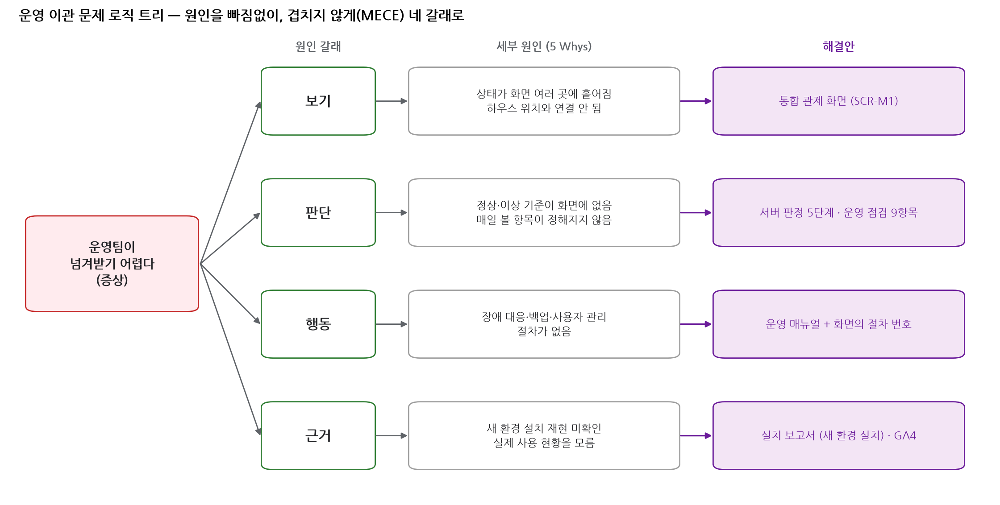
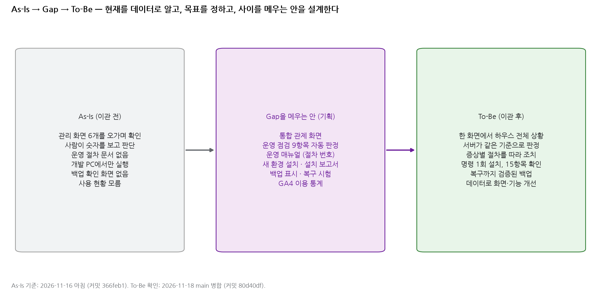
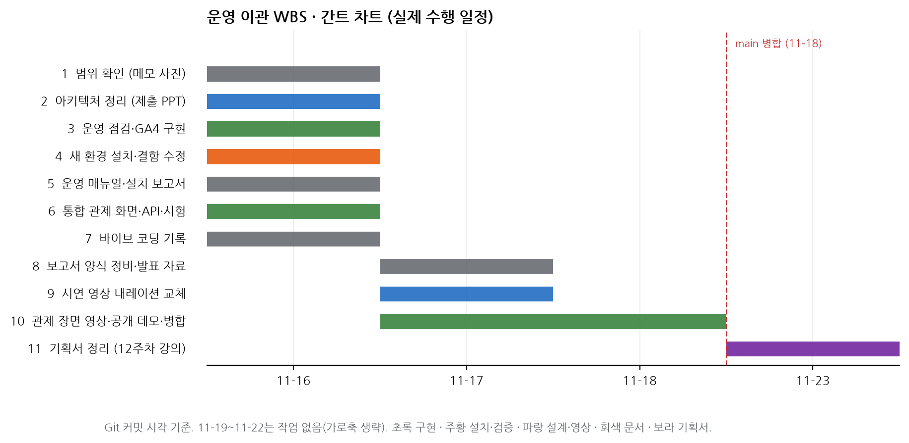

# TODAK 운영 이관 기획서 v1.0

## 한 장 요약

| 질문 | 답 |
|---|---|
| **왜** (문제) | 개발을 마친 TODAK 시스템을 운영팀이 넘겨받아도, 매일 무엇을 보고 장애가 나면 무엇을 해야 하는지 정한 문서와 화면이 없었다. 상태는 여러 관리 화면에 흩어져 있었고, 새 환경에 그대로 설치되는지도 확인한 적이 없었다 |
| **무엇을** (해결안) | ① 하우스 평면 위 **통합 관제 화면** ② 9개 항목을 자동 판정하는 **운영 점검 화면** ③ **GA4 이용 통계** ④ **운영 매뉴얼** ⑤ 새 환경 설치로 검증한 **설치 보고서** |
| **얼마나** (목표·KPI) | 일일 점검 9개 항목 100% 자동 판정, 새 환경 한 번 명령으로 설치하고 확인 15항목 중 14개 이상 통과, 백업 → 복구 데이터 100% 일치, 자동 시험 100% 통과, 매뉴얼 절차 번호와 화면 표시 100% 일치 |
| **언제까지** | 2026-11-16 ~ 11-18 (3일, 바이브 코딩으로 기획 → 구현 → 검증 반복), 11-23 기획서 정리 |
| **결과** | 목표 7개 중 6개 달성, 1개(GA4 실제 수집)는 측정 ID 발급 후 확인 (4장) |

## 1. 개요

### 1.1 이 문서의 목적

12주차 강의 '기획(企劃)이란 무엇인가'의 틀 — **기획의 여섯 단계**와 **기획서의 아홉 항목** — 에 맞추어, 메모의 '시스템 개발 이후 운영팀 이관' 작업을 기획서로 정리한다. 운영 이관은 바이브 코딩(기획 → 지시 → 생성 → 검증 → 수정)으로 기획과 실행을 짧게 반복했기 때문에, 각 항목에 계획과 함께 **실제로 확인한 결과**를 나란히 적었다. 강의의 말대로 기획은 가설이고, 검증은 사람의 몫이기 때문이다.

### 1.2 강의 틀과 이 문서의 대응

| 강의의 기획 단계 | 기획서 항목 (강의 25쪽) | 이 문서 |
|---|---|---|
| ① 문제 정의 | 1. 배경과 문제 | 2장 |
| ② 현황 분석 | 1. 배경과 문제 (As-Is·근거 데이터), 3. 대상과 사용자 | 3장 |
| ③ 목표 설정 | 2. 목표와 성공 기준 | 4장 |
| — | 4. 범위 | 5장 |
| ④ 해결안 도출 | 5. 해결안과 기능 | 6장 |
| — | 6. 데이터와 지표 | 7장 |
| ⑤ 실행 계획 | 7. 일정·인력·예산 | 8장 |
| ⑥ 검증·보고 | 8. 리스크와 검증 | 9장 |
| — | 9. 기대 효과 | 10장 |
| 기말 과제 포인트 (강의 25쪽) | 대시보드·코드 관리·유지 운영 | 11장 |
| Part 6 기획과 AI | 바이브 코딩, R-C-T-F, 사람과 AI의 역할 | 12장 |
| Part 5 중간 과제 되짚기 (강의 24쪽) | 보고서를 기획서로 읽기 | 13장 |

### 1.3 시스템 바로가기

| 항목 | 주소 |
|---|---|
| 웹 사이트 — 로그인 없이 둘러보기 (통합 관제·운영 점검 포함) | https://jiwon2324.github.io/TODAK-SmartFarm/app/demo |
| 통합 관제 화면 | https://jiwon2324.github.io/TODAK-SmartFarm/app/monitor |
| 시연 영상 (통합 관제 장면은 3:39부터) | https://jiwon2324.github.io/TODAK-SmartFarm/Demo/ |
| 소스 코드와 변경 이력 | https://github.com/jiwon2324/TODAK-SmartFarm |

## 2. 배경과 문제 — ① 문제 정의

### 2.1 증상과 원인

| 구분 | 내용 |
|---|---|
| 증상 (눈에 보이는 것) | "개발은 끝났는데 운영팀에 어떻게 넘기지?" — 메모 '운영팀에 이관을 위해 필요한 것: 운영 매뉴얼, 설치 보고서' |
| 원인 (기획이 풀 대상) | 운영자가 **매일 볼 한 화면**, **판단 기준**, **따라 할 절차**, **재현 가능한 설치 근거**가 없다 |

### 2.2 5 Whys

| 단계 | 질문 | 답 |
|---|---|---|
| 1 | 왜 운영팀이 넘겨받기 어려운가? | 무엇을 매일 확인하고, 이상하면 무엇을 할지 정해져 있지 않다 |
| 2 | 왜 정해져 있지 않은가? | 개발 문서(제안서·계획서·보고서)는 '무엇을 만들었는가'를 쓰고, '어떻게 운영하는가'는 쓰지 않았다 |
| 3 | 왜 화면만 보고 판단할 수 없는가? | 상태가 관리자 대시보드·로그·장비 화면에 흩어져 있고, '정상인가'를 판정해 주는 곳이 없다 |
| 4 | 왜 판정 기준이 없는가? | 기준값·안전 한계는 자동 제어 코드 안에만 있고 사람이 보는 화면에는 드러나지 않는다 |
| 5 | 왜 설치를 믿을 수 없는가? | 개발 PC에서만 실행했고, 깨끗한 환경에서 처음부터 설치해 본 기록이 없다 |

### 2.3 로직 트리 (MECE)

| 갈래 | 세부 문제 | 해결안 (6장) |
|---|---|---|
| 보기 (상황 인지) | 상태가 여러 화면에 흩어짐, 하우스 위치와 연결이 안 됨 | 통합 관제 화면 |
| 판단 (기준) | 정상·이상 판정 기준이 화면에 없음, 매일 볼 항목 미정 | 서버 판정(관제 5단계), 운영 점검 9개 항목 |
| 행동 (절차) | 장애 대응·백업·사용자 관리 절차 없음 | 운영 매뉴얼 (화면에 절차 번호 표시) |
| 근거 (재현·개선) | 설치 재현성 미확인, 실제 사용 현황 모름 | 설치 보고서(새 환경 설치), GA4 |

## 3. 현황 분석 — ② As-Is

### 3.1 As-Is와 To-Be

| 구분 | As-Is (이관 전, 2026-11-16 아침, 커밋 366feb1) | To-Be (이관 후) |
|---|---|---|
| 상황 보기 | 관리자 대시보드·로그·장비 화면 6개를 오가며 확인 | 통합 관제 한 화면 (하우스 평면 위 센서 11·장치 11) |
| 판정 | 사람이 숫자를 보고 판단 | 서버가 5단계 판정, 9개 점검 항목 자동 판정 |
| 절차 | 없음 (README의 실행 방법만) | 운영 매뉴얼 12장 + 화면에 절차 번호 |
| 설치 | 개발 PC에서만 실행 | 깨끗한 환경 설치 기록, 확인 15항목 |
| 백업 | 스크립트만 있고 확인 화면 없음 | 운영 점검 화면에 마지막 백업 표시, 복구 시험 |
| 사용 현황 | 알 수 없음 | GA4 이벤트 9종 (측정 ID만 넣으면 수집) |

### 3.2 5W1H

| 항목 | 내용 |
|---|---|
| Who (누가) | 운영 관리자·시스템 담당·농가 담당 (운영팀), 검수자 |
| When (언제) | 매일 09:00 일일 점검, 근무 중 상시 관제, 장애 발생 시 |
| Where (어디서) | 관리자 사이트(웹), 관제용 모니터(전체 화면), 서버 |
| What (무엇을) | 수집·통신·장치·경보·백업·디스크 상태 확인과 조치 |
| Why (왜) | 야간·주말에도 하우스 이상을 놓치지 않고, 장애를 같은 순서로 처리하려고 |
| How (어떻게) | 화면이 판정하고, 매뉴얼의 절차 번호를 따라 조치하고, 점검표를 남긴다 |

### 3.3 SWOT

| | 도움이 되는 것 | 해가 되는 것 |
|---|---|---|
| **내부** | **강점(S)**: 수집·자동 제어·경보가 이미 동작, 자동 시험 체계, 시뮬레이터로 이상 상황 재현 가능 | **약점(W)**: 운영 문서·점검 화면 없음, 설치 재현 미확인, 실장비 미연결 |
| **외부** | **기회(O)**: 바이브 코딩으로 짧은 주기에 만들고 검증, 공개 데모·영상으로 검수자가 바로 확인 | **위협(T)**: AI가 그럴듯하지만 틀린 문구를 쓸 수 있음, 외부 통계 도구의 개인정보 문제, 실제 운영 서버·HTTPS 미구축 |

### 3.4 대상과 사용자 (기획서 항목 3)

| 사용자 | 상황 | 필요한 것 |
|---|---|---|
| 운영 관리자 | 매일 아침 5분 안에 전체 상태를 확인해야 함 | 종합 판정 한 줄, 문제 항목과 조치 번호 |
| 시스템 담당 | 장애가 나면 원인과 순서를 바로 찾아야 함 | 증상별 절차, 로그 위치, 재시작·복구 명령 |
| 농가 (하우스 운영자) | 현장에 상주하기 어려움 | 하우스 위치별 이상 표시, 경보 |
| 검수자 (교수님) | 설치 없이 결과를 확인해야 함 | 로그인 없는 공개 데모, 시연 영상, 문서 |

사용자 여정 (운영 관리자의 하루): 09:00 운영 점검 화면 → '확인 필요' 항목의 절차 번호(예: 매뉴얼 4.2)를 펴서 조치 → 점검표 CSV 저장 → 근무 중 통합 관제를 전체 화면으로 띄움 → 빨간 경보가 뜨면 6장 장애 대응 절차.

## 4. 목표와 성공 기준 — ③ SMART · KPI

### 4.1 SMART 목표

| SMART | 이 기획의 목표 |
|---|---|
| S · 구체적 | 운영자가 매일 보는 항목 9개를 정하고 서버가 자동 판정한다 |
| M · 측정 가능 | 아래 KPI 7개를 숫자로 확인한다 |
| A · 달성 가능 | 새 테이블 없이 기존 22개 테이블·API 위에 만든다 (새 Framework 0개) |
| R · 문제와 관련 | 2장의 원인 네 갈래(보기·판단·행동·근거)에 하나씩 대응한다 |
| T · 기한 | 2026-11-16 ~ 11-18 (3일) |

### 4.2 KPI와 실제 결과

| # | 지표 | 목표값 | 측정 방법 | 실제 결과 | 판정 |
|---|---|---|---|---|---|
| K1 | 일일 점검 자동 판정 항목 | 9개 100% | 운영 점검 API 응답 | 9개 판정 (MQTT·게이트웨이·수집·센서·경보·제어·오류·백업·디스크) | 달성 |
| K2 | 관제 판정 반영 시간 | 새 값 즉시, 판정 3초 이내 | 고온 시나리오 화면 확인 | 값 즉시(SSE), 판정 3초 안에 재조회 | 달성 |
| K3 | 새 환경 설치 | 명령 1회, 확인 15항목 중 14개 이상 | 설치 보고서 6장 | 1분 17초, 14/15 통과 | 달성 |
| K4 | 백업 → 복구 일치 | 100% | 임시 MySQL 복구 후 건수 비교 | 테이블 23개, 측정값 22,231건 일치 | 달성 |
| K5 | 자동 시험 통과율 | 100% | 백엔드·프런트엔드 시험 | 80/80, 18/18 | 달성 |
| K6 | 매뉴얼 절차 번호와 화면 일치 | 100% | 문서·코드 대조 | 운영 점검 9개 항목 전부 일치 | 달성 |
| K7 | 이용 통계 수집 | GA4 실시간 보고서에 이벤트 표시 | GA4 콘솔 | 코드·빌드 확인, **측정 ID 미발급으로 실제 수집 미확인** | 보류 |

### 4.3 기존 계획서 KPI와의 연결

개발 계획서(02)의 KPI 중 **시스템 가동률(월 99.5%)**, **재배 기준 이탈 시간 감소**, **예상 노동 시간 절감**은 운영을 시작해야 잴 수 있는 지표다. 이번 운영 이관은 이 지표를 잴 수 있는 도구(운영 점검 화면의 가동 시간, 관제의 기준 이탈 판정, GA4 사용 기록)를 마련한 단계이며, 측정은 운영 1개월 뒤로 남긴다.

## 5. 범위 — 포함(In)과 제외(Out)

| 포함 (In) | 제외 (Out) |
|---|---|
| 통합 관제 화면·API (SCR-M1) | 새로운 재배 기능 (수확 판별 등 확장 범위) |
| 운영 점검 화면·API (SCR-A7) | 실장비(A안) 연결과 전기 공사 |
| GA4 연동과 개인정보처리방침 고지 | 운영 서버 구매·설치, HTTPS 인증서 |
| 운영 매뉴얼, 설치 보고서, 소프트웨어 아키텍처 | 문자·푸시 알림 (유료, 확장 계획) |
| 설치 중 발견한 결함 수정 | 시뮬레이터 동작 규칙 변경 |
| 공개 데모·시연 영상 갱신 | GA4 속성 생성 (Google 계정 필요) |

## 6. 해결안과 기능 — ④ 대안 비교와 선택

| 문제 | 대안 | 선택 | 선택 이유 |
|---|---|---|---|
| 상황을 한눈에 | A 기존 대시보드에 카드 추가 / B 별도 관제 화면 + 서버 판정 / C 외부 BI 도구(Grafana 등) | **B** | 하우스 위치(PPT 배치도)와 판정을 함께 보여야 하고, 판정 기준이 자동 제어와 같아야 함. C는 새 서버·권한 체계가 필요 |
| 매일 볼 항목 | A 종이 체크리스트 / B 서버 자동 판정 | **B** | 사람이 숫자를 읽고 판단하면 사람마다 결과가 다름. 판정과 절차 번호를 함께 보여 줌 |
| 판정 위치 | A 화면(브라우저)에서 계산 / B 서버에서 계산 | **B** | 관제·경보·자동 제어가 한 기준을 쓰게 하려고 |
| 실시간 전달 | A WebSocket / B 기존 SSE 재사용 | **B** | 서버 → 화면 한 방향이면 충분, 기존 권한 검사 재사용 |
| 사용 현황 | A 자체 접속 로그 / B GA4 | **B** | 화면·기기·기능 사용 보고서를 바로 씀. 개인정보는 보내지 않고 역할만 보냄 |
| 설치 근거 | A README 절차만 / B 깨끗한 환경에 실제 설치 | **B** | 시험으로는 드러나지 않는 결함(기동 순서 등)을 찾기 위해 |

## 7. 데이터와 지표 (기획서 항목 6)

| 데이터 | 출처 | 보관 | 어디에 쓰는가 |
|---|---|---|---|
| 센서 측정값 (11채널, 1분) | 게이트웨이 → MQTT → TB_SENSOR_DATA | 원시 3년, 시간 집계 영구 | 관제 판정, 그래프 |
| 재배 기준값·안전 규칙 | TB_CROP_STD, TB_CONTROL_RULE | 버전 이력 보관 | 관제 판정 기준 (주의·경보) |
| 경보·명령·상태 변경 | TB_ALERT, TB_CONTROL_COMMAND, TB_CONTROL_LOG | 영구 | 관제 실시간 이벤트, 운영 점검 |
| 서버 상태 | JVM·디스크·MQTT 연결·오류 로그 | 오류 로그는 메모리 200건 | 운영 점검 9개 항목 |
| DB 백업 파일 | tools/backup-db.sh → backups/ | 7일 + 외부 사본 | 운영 점검 '백업', 복구 |
| 이용 통계 | GA4 (page_view + 기능 이벤트 8종) | 14개월 | 화면·기능 사용 현황 |

## 8. 실행 계획 — ⑤ WBS · 간트 차트

| WBS | 작업 | 산출물 | 일자 |
|---|---|---|---|
| 1 | 범위 확인 (메모 사진 → 4가지 산출물 선택) | 작업 목록 | 11-16 |
| 2 | 아키텍처 정리 (제출 PPT 기준) | 소프트웨어 아키텍처 그림 | 11-16 |
| 3 | 운영 점검 화면·API, GA4 | SCR-A7, analytics.ts | 11-16 |
| 4 | 새 환경 설치·결함 수정 | 설치 기록, 결함 2건 수정 | 11-16 |
| 5 | 운영 매뉴얼·설치 보고서 | 08·09 | 11-16 |
| 6 | 통합 관제 화면·API·시험 | SCR-M1, 시험 5건 | 11-16 |
| 7 | 바이브 코딩 기록 | 11 | 11-16 |
| 8 | 보고서 양식 정비·발표 자료 | 08·09·11 PPT, 12 | 11-17 |
| 9 | 시연 영상 내레이션 교체 | 06 | 11-17 |
| 10 | 관제 장면 영상·공개 데모 갱신, 최종 점검, main 병합 | 06, /app/monitor | 11-17 ~ 11-18 |
| 11 | 기획서 정리 (12주차 강의 반영) | 13 (이 문서) | 11-23 |

인력: 개발·문서 1명(양지원) + AI 코딩 도구(Claude Code). 예산: 추가 비용은 음성 합성 크레딧 소량뿐, 서버·라이선스 추가 비용 없음.

## 9. 리스크와 검증 — ⑥

### 9.1 리스크 (가능성 × 영향, 1~5)

| ID | 위험 | 가능성 | 영향 | 점수 | 대응 | 실제 |
|---|---|---|---|---|---|---|
| OR-01 | AI가 쓴 문서가 실제 화면과 다름 | 4 | 3 | 12 | 문서를 코드와 대조 | **발생** — '점검 중 상태', '변경 사유 입력 칸'을 찾아 고침 |
| OR-02 | 시험은 통과하지만 새 환경에서 실패 | 3 | 4 | 12 | 깨끗한 환경에 실제 설치 | **발생** — 기동 순서 결함, 미개통 게이트웨이 오판정 수정 |
| OR-03 | 공개 데모에 개인정보 노출 | 2 | 5 | 10 | 기록 시 이메일 가진 계정 제외, 공개 전 검사 | 검사 결과 이메일 0건 |
| OR-04 | 외부 통계 도구로 개인정보 전송 | 2 | 4 | 8 | 역할만 전송, 개인정보처리방침 6항 고지 | 단위 시험으로 확인 |
| OR-05 | 화면 판정과 자동 제어 기준이 어긋남 | 2 | 4 | 8 | 판정을 서버 한 곳에서 같은 기준으로 | 통합 시험으로 확인 |
| OR-06 | 문서 장 번호와 화면 절차 번호 불일치 | 3 | 2 | 6 | 장 번호를 바꿀 때 코드도 함께 수정, 자동 대조 | 9개 항목 일치 |
| OR-07 | 4K 영상 처리 중 자원 부족 | 2 | 2 | 4 | 조각으로 나눠 처리 | **발생** — 메모리 부족 후 조각 처리로 해결 |

### 9.2 검증 방법

| 무엇을 | 어떻게 | 결과 |
|---|---|---|
| 기능 | 백엔드 통합 시험(실제 MySQL), 프런트엔드 단위 시험 | 80/80, 18/18 |
| 설치 | 깨끗한 환경 설치, 확인 15항목 | 14/15 (GA4 보류) |
| 데이터 | 백업 → 임시 DB 복구, 건수 비교 | 일치 |
| 화면 | 브라우저에서 PC·휴대폰 폭 확인, 고온 시나리오로 경보 변화 확인 | 가로 넘침 없음, 경보 표시 확인 |
| 문서 | 장 번호·숫자·버전·링크를 코드·증빙과 자동 대조 | 불일치 0건 |

## 10. 기대 효과

| 구분 | 효과 |
|---|---|
| 정량 | 매일 확인할 항목 9개를 한 화면에서 자동 판정 / 장애 증상 6종에 절차 번호 연결 / 설치 1분 17초(캐시 있는 개발 PC 기준) / 백업 복구 검증 |
| 정성 | 운영자마다 다르던 판단을 같은 기준으로 / 하우스 위치와 이상 상황을 함께 봄 / 검수자가 설치 없이 결과 확인 / 사용 현황을 데이터로 개선할 기반 |

## 11. 대시보드·코드 관리·유지 운영 — 기말 과제 관점 (강의 25쪽)

| 강의의 질문 | 이 기획의 답 |
|---|---|
| 지표가 질문에서 나왔는가 | 관제는 "지금 하우스 어디에 이상이 있는가?", 운영 점검은 "오늘 운영에 문제가 없는가?"라는 질문에서 지표를 골랐다 (판정 5단계, 점검 9항목) |
| 목표와 연결되는가 | 판정 기준이 재배 기준값·안전 한계(CR-05·06)와 같아서, 빨간색 하나가 곧 '목표를 벗어났다'는 뜻이다 |
| 코드를 관리하는가 | Git으로 모든 변경을 기록했다. 운영 이관은 별도 브랜치(ops-handover)에서 6개 커밋으로 진행한 뒤 main에 병합했고, 커밋마다 무엇을 왜 바꾸었는지와 시험 결과를 적었다. 문제가 생기면 커밋 단위로 되돌릴 수 있다 |
| 유지·운영까지 | 운영 매뉴얼에 일일·주간·월간 점검, 업데이트·되돌리기 절차, 문서 개정 규칙(12장)을 넣었다 |

## 12. 기획과 AI — 바이브 코딩 (강의 Part 6)

### 12.1 기획 → 지시 → 생성 → 검증 → 수정

| 단계 | 이번 작업에서 |
|---|---|
| 기획 | 메모 사진으로 범위를 정하고, 제출 PPT를 기준으로 삼음 |
| 지시 | "위 사진에 있는 내용 가지고 만들어야 돼", "PPT 보고서를 기반으로 관제 시스템도 넣어줬어? (코드를 짜줘야 함)" |
| 생성 | AI가 코드·문서·발표 자료 초안 작성 |
| 검증 | 시험, 새 환경 설치, 브라우저 확인, 시나리오, 문서 자동 대조 |
| 수정 | 오류 문구·결함·겹친 화면·장 번호를 고치고 다시 지시 |

### 12.2 R-C-T-F와 기획서

| 프롬프트 | 기획서에서 대응하는 것 | 이번 작업의 예 |
|---|---|---|
| R · 역할 | 사용자·이해관계자 | 운영팀이 넘겨받아 쓰는 화면·문서 |
| C · 맥락 | 배경·문제·제약 | 제출한 PPT 5개, 시뮬레이터(B안) 데이터, 기말고사 대체과제 |
| T · 작업 | 목표·기능·범위 | 운영 매뉴얼·설치 보고서·관리자 기능·GA4, 관제 소프트웨어 |
| F · 형식 | 산출물과 검수 기준 | Word·PPT, 01 제안서와 같은 양식, 목차·결론, 시스템 링크 |

### 12.3 사람과 AI의 역할

| 사람이 정한 것 | AI가 도운 것 |
|---|---|
| 무엇을 만들지(범위), 기준으로 삼을 PPT, 기말고사 대체과제 표기, 목소리 선택, 커밋·병합 시점 | 코드·문서·발표 자료 초안, 누락 항목 점검, 문서와 코드 대조, 설치·시험 실행 |

## 13. 중간 과제 산출물을 기획서로 읽기 (강의 24쪽)

| 기획 질문 | 답이 있는 곳 (중간고사 대체 과제) |
|---|---|
| 왜 필요한가 (문제) | 01 제안서 '제안 배경과 필요성' — 손 농사 6가지 작업, 야간·주말 관리 공백, 양평 겨울 저온 |
| 누구를 위한가 (사용자) | 01 제안서 '제안 시스템 구성 > 데이터와 화면'의 유스케이스 다이어그램 — 농가·관리자·검수자·스케줄러 |
| 무엇을 만들고 무엇은 만들지 않는가 (범위) | 01 제안서 '제안 목표와 범위' — MVP 16건, 확장 2건, 범위 밖(파종·수정·수확 기계화 등) |
| 어떤 데이터를 얼마나 보관하는가 | 04 완료 보고서 '최종 데이터베이스 구성' — 원시 1분 데이터 3년, 시간 집계 영구, 일 1회 백업 |
| 성공을 어떻게 아는가 (KPI) | 01 제안서 '제안 목표와 범위'의 핵심 성과지표 표 — 저장 성공률 99.9%, 제어 응답 p95 5초 등 10개 |
| 얼마나 걸리고 무엇이 위험한가 | 01 제안서 '수행 계획'·'위험 관리' — 12주 4관문, 위험 R-01~08 |

이번 운영 이관은 중간 과제의 '무엇을 만들었는가'에 이어, **'어떻게 운영하고, 어떻게 확인할 것인가'**를 기획한 단계다.

## 14. 결론

운영 이관 기획은 "개발은 끝났는데 어떻게 넘기지?"라는 증상에서 출발해, 원인을 **보기·판단·행동·근거** 네 갈래로 나누고, 각각에 통합 관제·운영 점검·운영 매뉴얼·설치 보고서(+GA4)를 해결안으로 골랐다. KPI 7개 중 6개를 실제 결과로 확인했고, 1개(GA4 실제 수집)는 측정 ID 발급 후 확인으로 남겼다.

12주차 강의의 말처럼 기획은 '이렇게 하면 된다'가 아니라 '이렇게 하면 될 것이라고 가정하고, 이렇게 확인하겠다'를 담아야 한다. 이번 작업에서도 계획한 것보다 **확인 단계에서 찾은 문제**(AI 문구 오류, 설치 결함, 깨질 뻔한 링크)가 결과의 품질을 좌우했다. 운영을 시작하면 4.3절의 운영 지표(가동률, 기준 이탈 시간, 노동 시간)를 측정해 다음 기획의 As-Is로 삼는다.
